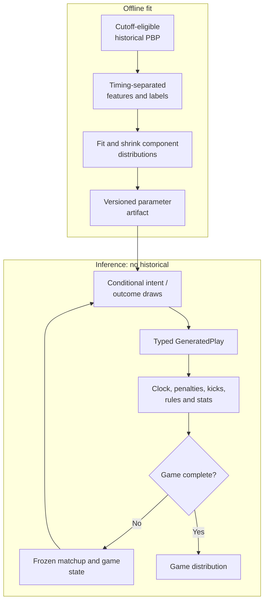
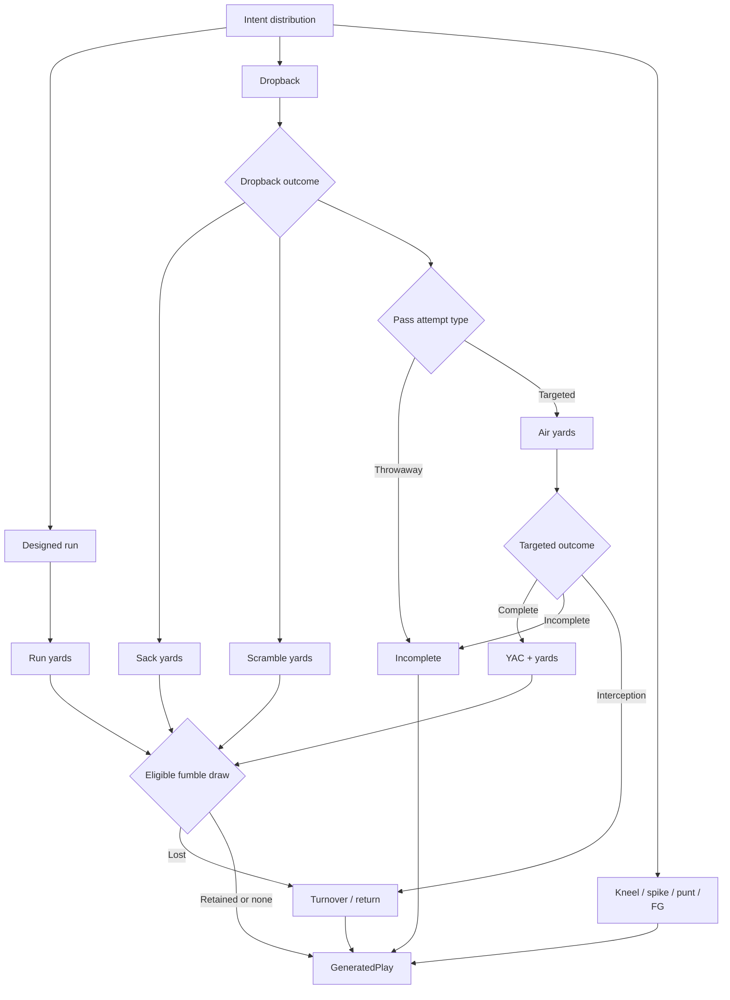
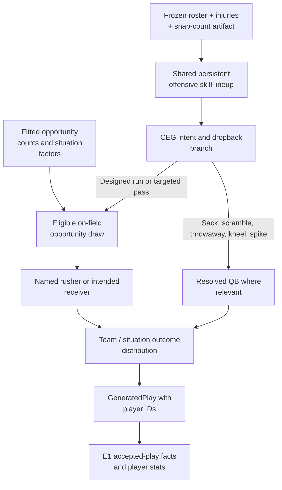
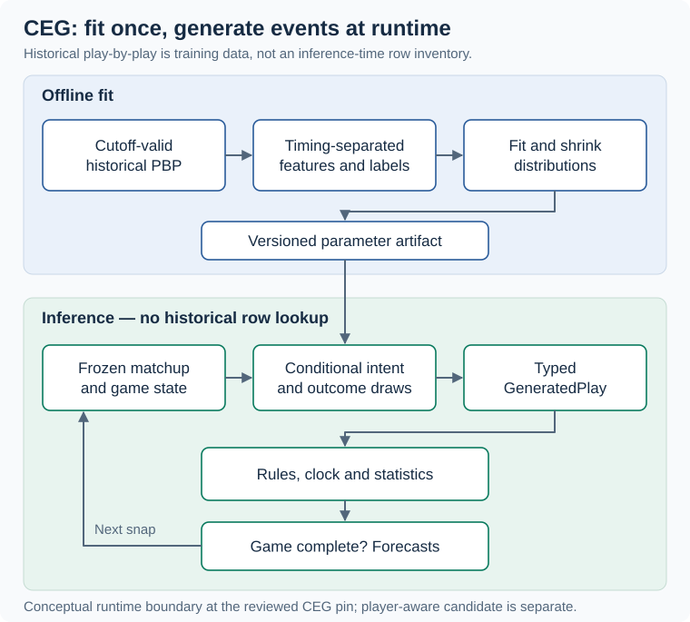

# CEG — Conditional Event Generation

[Architecture](README.md) · [CEG model card](../model-cards/nfl/ceg.md)

**Definition:** a statistical SLC engine that replaces dependence on finding a similar historical play with fitted conditional distributions for the next legal event and its quantities. Historical play-by-play is training and validation data, not a mandatory runtime row inventory. This definition is from the owner's [original November 24 plan](https://github.com/micahp/legendarypicks/blob/8d86d430/docs/research/SLC-CONDITIONAL-EVENT-GENERATION-PLAN.md), not a new interpretation of the acronym.

## Execution

Game situation -> conditional intent/event distributions -> generated quantities (run yards, air yards, catch, YAC, returns, clock, foul, kick) -> typed play facts -> football rules and next state -> repeat. The model is not a physical all-22 simulator and does not generate an exact future game. Fitted conditional distributions regularize sparse cells; unlike V2 historical sampling, a matching historical row is not required at inference. Phase 5/7 reports a parameter-only runtime with data reads blocked.

See the [cross-model diagnosis and pace-versus-efficiency evaluation standard](../evaluation/MODEL-COMPARISON.md#cross-model-diagnosis-pace-efficiency-and-mechanism). Removing runtime row selection does not prove correct fitted joint outcomes or clock cadence. Validate both pace and efficiency against NFL evidence.

## Scrimmage factorization and evidence

The Phase 2 generator implements this conditional chain:

```text
intent
  designed run -> run yards
  dropback -> sack / scramble / pass attempt
      sack -> sack yards
      scramble -> scramble yards
      attempt -> throwaway / targeted
          targeted -> air yards -> targeted outcome
              completion -> yards after catch
  kneel / spike / punt / field goal
eligible run/scramble/sack/completion -> fumble -> lost or retained
turnover -> return model
```

The Phase 2 fit uses 2022–2024, scores 2025 confirmation and examined 2026 weeks separately. Arm C's situation-conditioned estimates beat B on 6 of 11 components in 2025; no established improvement for YAC, scramble yards, sack yards, fumble or lost-fumble. C-FTN failed its adoption rule: observed charting is not necessarily useful when it must be generated at inference. Ten of eleven components selected the heaviest preregistered shrinkage (k=300); more conditioning is not automatically better. Later phases add clocks, kicks, fouls and a parameter-only runtime. Do not treat Phase 2's fit-time table reader as the Phase 5 inference boundary.

Sources: [Generator source](https://github.com/micahp/legendarypicks/blob/8d86d430/scripts/nfl_sequence/ceg_generator.py) and [Phase 2 report](https://github.com/micahp/legendarypicks/blob/8d86d430/docs/research/slc-ceg-2026-11-24/PHASE2-SCRIMMAGE-REPORT.md).

## Contracts versus generator

| Contract | Scope |
|---|---|
| ceg-play-1 | Typed PlayCall, TimeoutDecision, GeneratedPlay, Clock, Penalty, Possession and Provenance. [Original contract](https://github.com/micahp/legendarypicks/blob/8d86d430/scripts/nfl_sequence/ceg_contract.py). |
| ceg-play-2 | Additive validated event facts for penalties, returns, roles, scoring, clock, spots and kicks; retains v1 API. [LP contract v2](https://github.com/micahp/legendarypicks/blob/50c15508/scripts/nfl_sequence/ceg_contract.py). |
| ceg-play-3 | Additive explicit coordinate frames, special-teams recovery/return and ordered turnover chains; other scrimmage may still use v2. [LP contract v3](https://github.com/micahp/legendarypicks/blob/50c15508/scripts/nfl_sequence/ceg_contract_v3.py). |

V2 event-expansion research uses the typed contract to represent historical facts without replacing V2's sampler. V1 Complete uses typed facts to transmit live Gridiron outcomes without substituting CEG distributions. [Reuse inventory](https://github.com/micahp/legendarypicks/blob/50c15508/docs/research/SLC-V2-EVENT-EXPANSION-INVENTORY-2026-11-24.md). Validate facts before applying rules, never silently repair or invent facts.

## Where the implementation and evidence live

Research branch: [research/slc-ceg-2026-11-24](https://github.com/micahp/legendarypicks/tree/research/slc-ceg-2026-11-24), reviewed pin `8d86d430`, based on frozen V2 `8a1d9842`. No merge into production is implied. [Authoritative phase overview](https://github.com/micahp/legendarypicks/blob/8d86d430/docs/research/slc-ceg-2026-11-24/README.md). Runtime data and fitted artifacts are reported outside Git under /root/slc-ceg-data; inspect hashes in original manifests, do not assume availability.

| Source | Responsibility |
|---|---|
| [ceg_generator.py](https://github.com/micahp/legendarypicks/blob/8d86d430/scripts/nfl_sequence/ceg_generator.py) | Conditional event generation |
| [ceg_game.py](https://github.com/micahp/legendarypicks/blob/8d86d430/scripts/nfl_sequence/ceg_game.py) | Full-game runtime |
| [ceg_contract.py](https://github.com/micahp/legendarypicks/blob/8d86d430/scripts/nfl_sequence/ceg_contract.py) | Typed facts and validation |
| [ceg_clock.py](https://github.com/micahp/legendarypicks/blob/8d86d430/scripts/nfl_sequence/ceg_clock.py) | Clock and timeout components |
| [ceg_special.py](https://github.com/micahp/legendarypicks/blob/8d86d430/scripts/nfl_sequence/ceg_special.py) | Special teams components |
| [ceg_event_tables.py](https://github.com/micahp/legendarypicks/blob/8d86d430/scripts/nfl_sequence/ceg_event_tables.py) | Timing-separated data tables |
| [ceg_phase7.py](https://github.com/micahp/legendarypicks/blob/8d86d430/scripts/nfl_sequence/ceg_phase7.py) | Full-game evaluation |

## Research phases

- [Historical dependencies](https://github.com/micahp/legendarypicks/blob/8d86d430/docs/research/slc-ceg-2026-11-24/PHASE0-DEPENDENCY-AUDIT.md)
- [225,829 source plays, canonical tables and exclusions](https://github.com/micahp/legendarypicks/blob/8d86d430/docs/research/slc-ceg-2026-11-24/PHASE1-DATASET-AUDIT.md)
- [Conditional scrimmage distributions](https://github.com/micahp/legendarypicks/blob/8d86d430/docs/research/slc-ceg-2026-11-24/PHASE2-SCRIMMAGE-REPORT.md)
- [Clock and timeout separation](https://github.com/micahp/legendarypicks/blob/8d86d430/docs/research/slc-ceg-2026-11-24/PHASE3-CLOCK-REPORT.md)
- [Kicks, tries, fouls, returns, OT](https://github.com/micahp/legendarypicks/blob/8d86d430/docs/research/slc-ceg-2026-11-24/PHASE4-SPECIAL-TEAMS-REPORT.md)
- [Offline generated-game runtime](https://github.com/micahp/legendarypicks/blob/8d86d430/docs/research/slc-ceg-2026-11-24/PHASE5-RUNTIME-REPORT.md)
- [Team and player differentiation](https://github.com/micahp/legendarypicks/blob/8d86d430/docs/research/slc-ceg-2026-11-24/PHASE6-DIFFERENTIATION-REPORT.md)
- [Realism and forecast performance](https://github.com/micahp/legendarypicks/blob/8d86d430/docs/research/slc-ceg-2026-11-24/PHASE7-EVALUATION-REPORT.md)
- [Yardage-based team shifts](https://github.com/micahp/legendarypicks/blob/8d86d430/docs/research/slc-ceg-2026-11-24/PHASE8-TEAM-STRENGTH-REPORT.md)
- [Drive-level team-strength tuning](https://github.com/micahp/legendarypicks/blob/8d86d430/docs/research/slc-ceg-2026-11-24/PHASE9-TEAM-STRENGTH-REPORT.md)
- [Contract review](https://github.com/micahp/legendarypicks/blob/8d86d430/docs/research/slc-ceg-2026-11-24/CONTRACT-REVIEW-ceg-play-2.md)
- [Candidate registry](https://github.com/micahp/legendarypicks/blob/8d86d430/docs/research/slc-ceg-2026-11-24/CANDIDATES.md)
- [Known unresolved work](https://github.com/micahp/legendarypicks/blob/8d86d430/docs/research/slc-ceg-2026-11-24/ENGINEERING-BACKLOG.md)
- [Transferable findings](https://github.com/micahp/legendarypicks/blob/8d86d430/docs/research/slc-ceg-2026-11-24/FINDINGS-FOR-V2-AND-V1-COMPLETE.md)

## Current status

Phase 7 reports 300/300 realism games and 1,160/1,160 forecast games completed with data reads blocked; this is scoped checker evidence, not independently proven complete NFL rule semantics. Mean points 20.11 vs 23.01 actual (2025); W11 13-game Brier CEG .245, V2 .205, market .183. Phase 9 did not establish a team-strength candidate beating no team terms on held-out drive points. Player attribution and scoring/team differentiation remain open. No promotion. See [model comparison](../evaluation/MODEL-COMPARISON.md).

## CEG training versus execution (visual)



## Scrimmage generation (visual)



## Player-aware candidate (November 26; not validated)



[Candidate code and handoff at e39e5bdd](https://github.com/micahp/legendarypicks/blob/e39e5bdd/docs/research/SLC-CEG-PLAYER-INTEGRATION-2026-11-26.md). The candidate replaces the Phase 6 retrospective opportunity-recipient candidate set with an eligible simulated lineup. Player attribution is not player-conditioned outcome ability. Formation-conditioned intent, defensive/kick attribution, complete official snap accounting, prospective validation and actual artifact/runtime verification are open. Earlier status in this page describes the frozen CEG research pin, not this later candidate.

For a fixed-layout alternative to the fit/inference diagram, see [CEG fit and runtime SVG](diagrams/ceg-fit-runtime.svg).



**Candidate integration 2026-11-27:** [`df6d8e6f`](https://github.com/micahp/legendarypicks/commit/df6d8e6ffd984d833472f44bec33426f93ff0917) advances the independent research branch from the frozen Phase 9 pin. In the player-aware diagram, the lineup is prepared before intent and attribution; the persistent stint advances only when E1 appends an accepted play (penalty replacement discards the pending lineup). Input preflight and stop-on-blocked single-matchup execution are implemented but not runtime-verified. The older multi-matchup evaluation path remains historical. Do not treat CEG's drive-checker completion as full NFL validity. The frozen baseline is still `8d86d430`. [Handoff](https://github.com/micahp/legendarypicks/blob/df6d8e6ffd984d833472f44bec33426f93ff0917/docs/research/SLC-CEG-PLAYER-INTEGRATION-2026-11-26.md).
