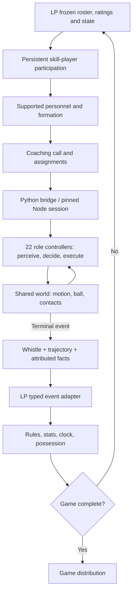

# Gridiron Physics

[Architecture](README.md) · [Liquid AI](LIQUID-AI.md) · [V1 Complete](../model-cards/nfl/slc-v1-complete.md)

Separate repository [micahp/gridiron-physics](https://github.com/micahp/gridiron-physics). Owns live players, movement, ball flight, interactions, authored formations/assignments, trajectories and rendering; LP owns authoritative rules, roster eligibility, game lifecycle and stats. Reviewed pair LP `50c15508` / Gridiron `058571b`.

## Live runtime

`play_autonomous_game()` -> `game_state.play_game()` -> `e1_drive.simulate()` -> `AutonomousGameExecution.event_source()` -> `build_call()` -> `GridironSession.play()` (persistent Node) -> `simulateAutonomousPlay()` -> `simulateInsideZone()` or `simulatePassPlay()` -> typed event mapping -> LP rules.

[Python callback](https://github.com/micahp/legendarypicks/blob/50c15508/scripts/nfl_sequence/autonomous_game.py#L397); [Call builder](https://github.com/micahp/legendarypicks/blob/50c15508/scripts/nfl_sequence/gridiron_bridge.py#L214); [JS dispatcher](https://github.com/micahp/gridiron-physics/blob/058571b/engine/autonomous/simulator.js); [World](https://github.com/micahp/gridiron-physics/blob/058571b/engine/world.js); [Special teams](https://github.com/micahp/gridiron-physics/blob/058571b/engine/autonomous/special-teams.js).

## Reuse inventory

- [Playbook documentation](https://github.com/micahp/gridiron-physics/blob/058571b/docs/PLAYBOOKS.md): NFL historical charted attributes, not recovered Madden plays or complete play calls. The November 23 audit reports 160 research profiles (32 teams x 2022–26); only 32 2025 JSONs checked in at this pin; 2026 incomplete participation. [Reuse audit](https://github.com/micahp/legendarypicks/blob/50c15508/docs/research/GRIDIRON-SLC-PLAYBOOK-REUSE-AUDIT-2026-11-23.md).
- [Nine reusable route geometries](https://github.com/micahp/gridiron-physics/blob/058571b/engine/routes.js); [Authored diagrams](https://github.com/micahp/gridiron-physics/blob/058571b/engine/autonomous/example-assignments.js): inside zone left/right, slant-flat, curls, four verticals, man/zone/rush/run fits. These are not team-specific playbooks.
- Current LP bridge uses fixed 11 personnel, inside zone right/assigned slant-flat fallback, nickel over and Cover 1; pre-snap richer policy not integrated. Coverage fallback corrected partially; no assertion of exact shell fidelity.

Known live-play defects: receiver future landing access, defender exact-state prediction and generic break-on-ball, role-transition gaps, callback order effects, recovery draws and timestep sensitivity. See [Liquid AI](LIQUID-AI.md). Avoid a second engine or new physics layers unless evidence justifies them.

## V1 Complete execution (visual)

This diagram describes the intended execution architecture with the November 26 [persistent-lineup candidate](https://github.com/micahp/legendarypicks/blob/847b3a22/docs/research/SLC-SHARED-PARTICIPATION-2026-11-26.md). Only offensive skill lineups persist; fixed 11 personnel, authored formation, defensive starters and restricted call library remain. No claim of all formations, defensive rotation or full-game validation. The physical world generates the outcome; no preassigned eventual receiver or historical outcome row.
