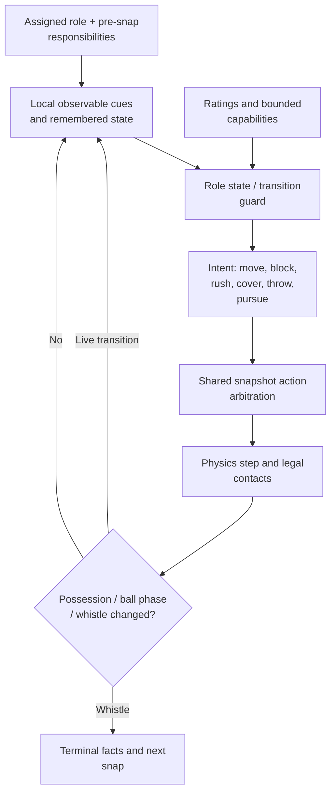
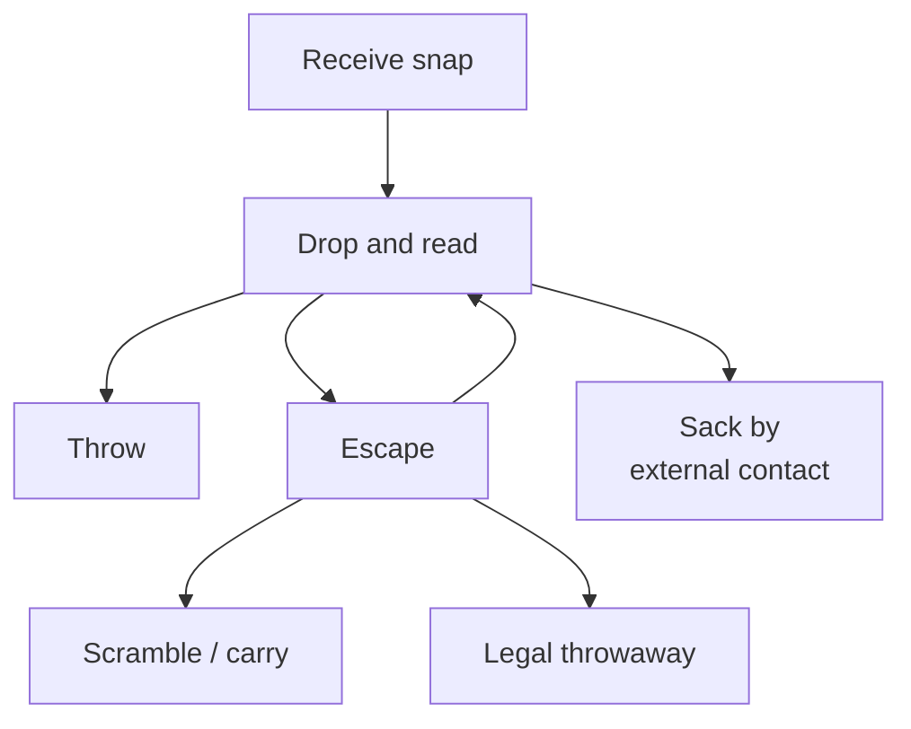
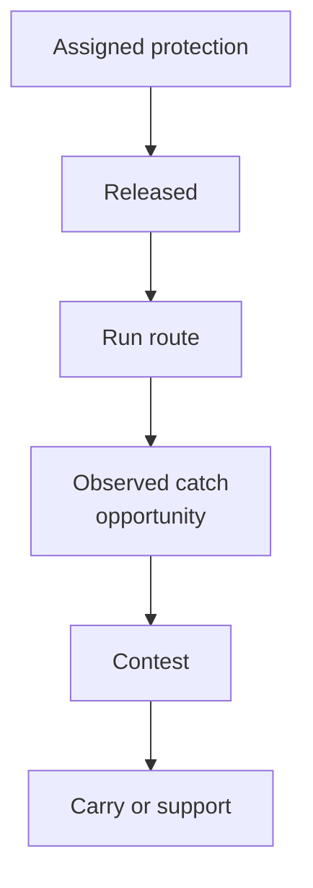
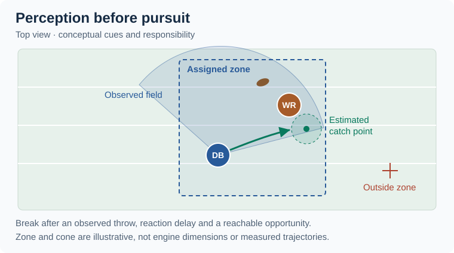
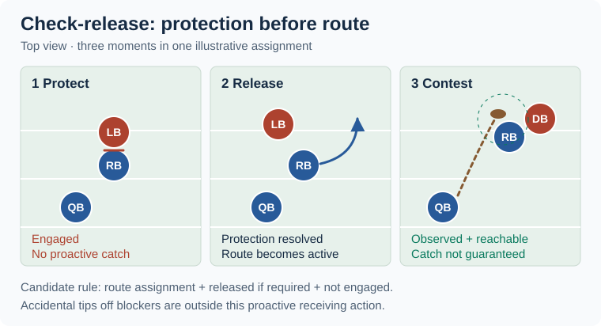

# Liquid AI-inspired football intelligence

[Gridiron](GRIDIRON.md) · [V1 Complete](../model-cards/nfl/slc-v1-complete.md)

EA's Liquid AI terminology is historical inspiration; original Madden algorithms are not recovered. Our approved V1 Complete design specifies small role- and assignment-specific reactive finite-state machines for all 22 players, based on available cues, bounded motion and local interactions. No full-body physics, animations, rich perception/memory or learning required. [Design and five acceptance gates](https://github.com/micahp/legendarypicks/blob/50c15508/docs/research/V1-COMPLETE-DESIGN.md); [Source audit](https://github.com/micahp/legendarypicks/blob/50c15508/docs/research/V1-COMPLETE-LIQUID-AI-ARCHITECTURE-AUDIT-2026-11-26.md); [Madden 64 mechanics matrix (moving research branch)](https://github.com/micahp/legendarypicks/blob/madden-on-main/docs/research/MADDEN64-MECHANICS-MATRIX.md).

## Existing behavior and required changes (not completed)

| Role | Current controller | Required transitions / corrections |
|---|---|---|
| QB | passing.js qbDecision/readOptions; drop, utility score, escape, throwaway | Receive -> drop/read/wait -> throw/scramble/legal throwaway; play-specific progression, consistent movement, no future observations; sack external |
| RB | autonomous-run.js rbBrain lane scoring/lock; pass check-release | Mesh -> press assigned gap -> read/cut -> open field; protection until resolved then release |
| WR | passing.js routeTarget, offenseBrain; waypoint index | Stem/break/finish -> relevant observed ball tracking -> contest -> carrier/support; remove W.ball.landing access |
| TE | shared block/route branch | Assigned protect or check/release -> route -> contest |
| C/G/T | shared blocker and target selection | Snap/set/engage/anchor/assist or release; constrain gap/edge/target to assignment; recognize assigned blitzers |
| DT/DE | run gap fits, pass rush, shed | Gap control or rush/contain -> engage/shed -> pursue; keep edge/gap responsibility until appropriate |
| LB | timed run read, man/zone/rush | Read -> fit/blitz/man/zone -> observed relevant reaction -> contest/pursue |
| CB/NB/S | run cue/delay/leverage; pass landmark/mirror then universal ball chase | Preserve coverage, route leverage and deep help; recognize throw, assess reachable contest or support, transition; reuse run recognition |
| Special teams | specialist, cover, return, block | Explicit kick/field/leave/fair catch, coverage/return/legal recovery transitions |
| Shared carrier/loose ball | pursuit and recovery functions | Stable possession transition, distinct contact opportunity, no repeated chance per tick |

Source locations: [QB](https://github.com/micahp/gridiron-physics/blob/058571b/engine/autonomous/passing.js#L486-L674), [Run brains](https://github.com/micahp/gridiron-physics/blob/058571b/engine/autonomous-run.js#L655-L884), [Pass brains](https://github.com/micahp/gridiron-physics/blob/058571b/engine/autonomous/passing.js#L1125-L1355), [Kick brains](https://github.com/micahp/gridiron-physics/blob/058571b/engine/autonomous/special-teams.js#L321-L405), [World.step](https://github.com/micahp/gridiron-physics/blob/058571b/engine/world.js#L364). These are implicit state/conditionals, not verified standalone FSM classes.

## Critical defects and evidence

In the sequential saved 220-call replay, fixing mismatched defensive assignments changed catches 5 to 121. In a separate shared-snapshot comparison, retro control 4 catches, delayed defender perception 49, detailed 46. Do not mix cohorts or claim NFL calibration. Receiver observation candidate 12b58c9 removed a future-location dependency but did not improve catch opportunities in the saved cohort. Shared-snapshot prototype [6b769777](https://github.com/micahp/gridiron-physics/blob/6b769777/engine/autonomous/passing.js) not wired to LP; it changes behavior, cannot silently alter frozen identity. See source audit above for reports and limits.

## Implementation order

Correct assignment and reaction logic, remove privileged observations, integrate consistent action arbitration and distinct contact opportunities, then complete state transitions using existing code. Prefer shared controller families over one class per position. Test actual assigned 11-on-11 runtime, legal state/clock/stats and replay; tune only after logic is sound. Madden is a behavioral reference, NFL data is statistical ground truth.

See the [cross-model diagnosis and pace-versus-efficiency evaluation standard](../evaluation/MODEL-COMPARISON.md#cross-model-diagnosis-pace-efficiency-and-mechanism). Correct player logic before tuning; separately measure live-ball duration, dead-ball runoff, pace and per-play efficiency rather than adopting Madden's aggregate rates.

## Reactive controller architecture (visual)

Example target role-state graphs (conceptual; not a claim of standalone FSM classes):

**Quarterback**

**Check-release receiver**

November 26 branch [e1f98a4](https://github.com/micahp/gridiron-physics/tree/e1f98a4) reports checklist completion, adds per-engagement shed RNG and throwaway guards, and strengthens selected tests. It remains an unmerged candidate. The separate [61eac5b4](https://github.com/micahp/gridiron-physics/tree/61eac5b4) candidate gates proactive receiver contact on release and uses an observed catch-height projection for assigned defenders. Do not conflate their pins or declare full-game readiness from local test reports. Source review shows e1f98a4 still checks only route kind in catchCandidates and still uses the ground-landing estimator for defenders. Reconcile and validate both changes before selecting a combined engine.

## Spatial controller schematics

This is a conceptual responsibility and reachability guard, not a claim that all contact paths enforce recognition.

The proactive receiving gate is a specific candidate change at [61eac5b4](https://github.com/micahp/gridiron-physics/blob/61eac5b4/engine/autonomous/passing.js); accidental tips remain outside its scope. [Editable schematic sources](diagrams/README.md).
