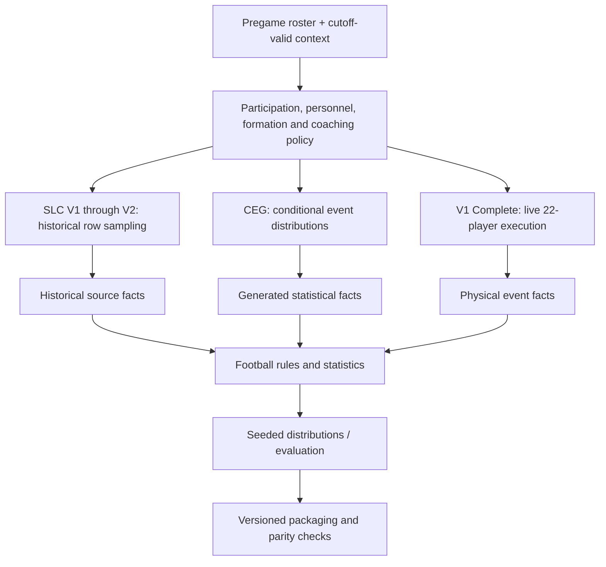

# Modeling architecture

[Handbook](../README.md) · [Glossary](GLOSSARY.md) · [Model registry](../model-cards/README.md)

Legendary Picks researches game and player forecasts across sports. Its NFL sequence research currently has three distinct execution strategies. All are research unless the relevant model card explicitly records adoption.

```text
Cutoff-valid matchup + roster + data + model identity
                  |
        Pre-snap decision policy (not yet unified)
          /              |                \
  SLC row sampler   CEG distributions   Gridiron live agents
  historical row    generated facts     physics and events
          \              |                /
         Football rules / possession / score / clock / statistics
                  |
        Seeded game distribution -> forecast evaluation
```

This is a conceptual relationship, not a claim that all three share one implementation or pre-snap policy today. [SLC](SLC.md) owns the statistical sequence family and game lifecycle. [CEG](CEG.md) is an alternative statistical event generator and also supplies typed event contracts; using a contract is not using the generator. [Gridiron](GRIDIRON.md) implements autonomous physical execution. [Liquid AI](LIQUID-AI.md) defines the proposed simple, assignment-specific reactive player intelligence for V1 Complete.

Other NFL team-rating and player-projection models (v1 points, EPA, Elo, Marcel-lite, Spec B) are not SLC versions; see [NFL card](../model-cards/nfl.md). Keep football legality, statistical realism, forecast accuracy, and deployability distinct.

## Current integration

- Historical V2 uses `PlayCallSampler.sample()` for both call and outcome; `game_state.play_game()` and `e1_drive.simulate()` advance the game. [V2 source](https://github.com/micahp/legendarypicks/blob/9a2e8624/scripts/nfl_sequence/slc_playcall.py#L429).
- V1 Complete bypasses that sampler via `AutonomousGameExecution.event_source()`, constructs a call via `gridiron_bridge.build_call()`, executes Gridiron over persistent Node, maps typed event facts, then applies LP rules. [LP source](https://github.com/micahp/legendarypicks/blob/50c15508/scripts/nfl_sequence/autonomous_game.py#L397) and [Gridiron source](https://github.com/micahp/gridiron-physics/blob/058571b/engine/autonomous/simulator.js#L121).
- CEG generates typed facts instead of historical rows; standalone runtime exists on its own branch. Shared contract versions are additive, not interchangeable. See [CEG](CEG.md).
- A reusable, executor-independent pre-snap policy is **proposed**, not implemented. Reuse formation/personnel priors, PBV1 and executable diagrams without importing preselected receiver or outcome into live play.

[Original contextual simulation specification](../SPEC-NFL-CONTEXTUAL-FULL-GAME-SIMULATION-2026-10-25.md) and [V1 Complete design](https://github.com/micahp/legendarypicks/blob/50c15508/docs/research/V1-COMPLETE-DESIGN.md) remain the historical/implementation-specific authorities.

## Model family comparison (visual)



**Target architecture, not fully shared runtime.** November 26 candidate CEG and V1 Complete share identical `shared_participation.py` source (blob `71731da9` at their initial published pins); V2 retains existing pre-event implementation. [PR #56](https://github.com/micahp/legendarypicks/pull/56) supplies HE bench-entry research, not mandatory PBV1 coupling; [PR #51](https://github.com/micahp/legendarypicks/pull/51) supplies packaging infrastructure, not the play generator. See the [SLC](SLC.md), [conditioning arms](../model-cards/nfl/slc-v2-simplified.md#conditioning-methods-visual), [CEG](CEG.md), [Gridiron](GRIDIRON.md) and [Liquid AI](LIQUID-AI.md) diagrams.
