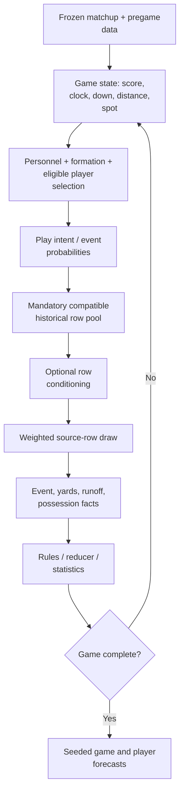
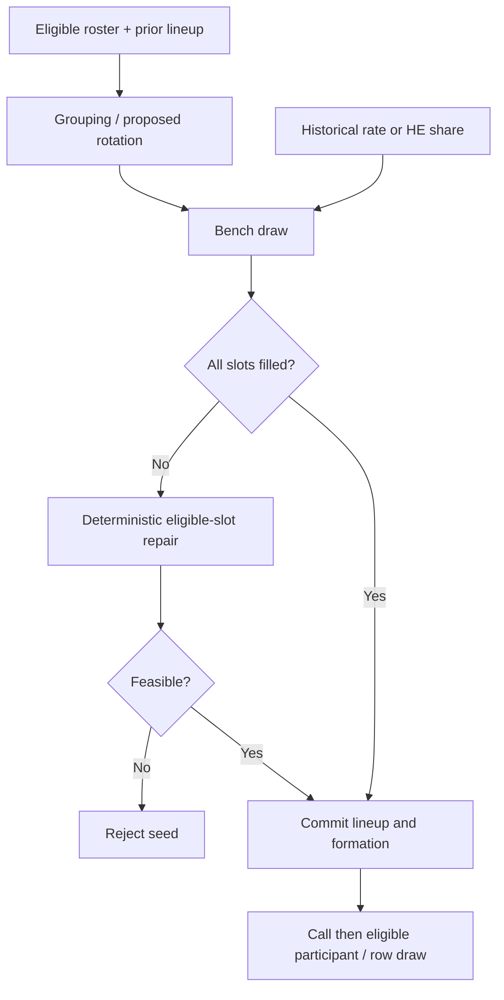

# SLC — Score-Clock Layered

[Architecture](README.md) · [Version registry](../model-cards/nfl/README.md)

SLC stands for **Score-Clock Layered**, as explicitly named in the [Original October 28 integration ledger](https://github.com/micahp/legendarypicks/blob/5f5887bc/docs/research/SLC-INTEGRATION-LEDGER-2026-10-28.md). It is the NFL full-game sequence modeling family. It simulates plays sequentially from a frozen matchup snapshot: down, distance, field position, clock, score, eligible personnel and prior data. Historical SLC variants draw a play event and historical source row using fitted probabilities and optional conditioning layers, then apply football rules. It generates a distribution of games, not an exact forecast of the next real game's play sequence.

```text
slc_engine.play -> game_state.play_game -> e1_drive.simulate
 -> PlayCallSampler.sample -> pre_event.chooser / choose
 -> event + source row + runoff + spot -> rules / stats -> next snap
```

In current V2, personnel-first preparation can advance the participation lineup before the run/pass draw, conditional on formation priors. PBV1 is explicitly rejected with personnel-first at the reviewed pin; do not silently combine them. V2 Simplified disables optional row filters but retains other upstream effects. V1 Pure is a separate minimal control, not simply a filter-off ablation.

Sources: [Game entry](https://github.com/micahp/legendarypicks/blob/9a2e8624/scripts/nfl_sequence/slc_engine.py#L444), [Call and outcome sampler](https://github.com/micahp/legendarypicks/blob/9a2e8624/scripts/nfl_sequence/slc_playcall.py#L429), [Personnel-first path](https://github.com/micahp/legendarypicks/blob/9a2e8624/scripts/nfl_sequence/pre_event.py#L426), [Row-conditioning arms](https://github.com/micahp/legendarypicks/blob/41a759e3/scripts/nfl_sequence/slc_playcall.py#L766). Frozen identities and build args come from [Portable registry](https://github.com/micahp/legendarypicks/blob/e0d3f603/scripts/nfl_sequence/slc_model_registry.py); a branch head is not a frozen model.

## Other execution strategies

[CEG](CEG.md) eliminates historical-row selection via fitted conditional distributions. [V1 Complete](../model-cards/nfl/slc-v1-complete.md) delegates live plays to [Gridiron](GRIDIRON.md); uses CEG typed contracts, not CEG's statistical generator.

See the [cross-model diagnosis and pace-versus-efficiency evaluation standard](../evaluation/MODEL-COMPARISON.md#cross-model-diagnosis-pace-efficiency-and-mechanism). Historical-row selection defects and game-clock pace must be diagnosed separately; do not use scoring compensation to conceal biased sampling.

## Data and evaluation

Pregame cutoff and provenance, player eligibility, independent seed streams and complete regulation/OT are required. Use original cohort-specific results; football realism alone cannot demonstrate forecasting skill. [Evaluation](../evaluation/README.md).

## Historical-row execution (visual)



The diagram is a conceptual personnel-first V2 research path, not the exact frozen V1/V1.5/V1.6/V1.7 order. See individual model cards and their pinned manifests for enabled layers. [Four conditioning methods](../model-cards/nfl/slc-v2-simplified.md#conditioning-methods-visual) shows the part of this flow that changes. CEG replaces the row draw, not the need for a rules engine.

## Batch acceptance boundary

The model-independent snapshot is a data artifact. Model readiness requires the selected runtime's actual pinned input/dependency checks. A smoke game is a complete engine run, not just snapshot parsing or package export. For strict batches the launcher requires each requested seed to complete legally with the required execution/statistics and verified snapshot provenance; legal completion and evidence verification are separate facts. Stop at the first rejected seed where the runtime supports it; for old frozen runtimes bound chunks and stop later waves. No replacement seeds or blind resumption. See [mandatory launch procedure](../API-AGENT-GUIDE.md#mandatory-model-readiness-and-batch-launch).

## Moving V2 participation candidate (2026-11-27)

At [`6d2db7e1`](https://github.com/micahp/legendarypicks/commit/6d2db7e1ec0cbebbeba08ce1049f1f64b08a2bad), the moving V2 path has the newer participation and PBV1 coupling code (not validated; the earlier reviewed pin rejected coupling). HE weights entry using prior active-game snap share; exit hazards remain distinct. Historical-rate HS is the explicit control. This changes candidate behavior, not frozen V2.



No full-engine or held-out evaluation was executed during consolidation. See [V2 card](../model-cards/nfl/slc-v2.md).

## Portable historical-pool representation (development)

The frozen historical engines may intentionally alias `reference.contextual_sampler.source_pool` to `reference.pool`. Legacy portable schema 1 serializes those occurrences independently, destroying that identity and allocating two historical pools at load. The exact V1.6 OOM investigation is recorded in the [memory audit](https://github.com/micahp/legendarypicks/blob/research/slc-week12-blackfriday-runs-2026-11-27/docs/research/SLC-PORTABLE-MODEL-PACKS-CONTEXT-2026-11-19.md).

Development portable schema 2 omits only that explicitly shared sampler field, streams the original pool once, and restores the alias before reference validation or simulation. Schema 1 remains readable without changing its object semantics. New builds use schema 2 only if the original objects are identical. No general deduplication of content-equal objects, training-data reduction or cross-worker sharing is implemented. The format change does not change frozen engine code, source digests or model identity.

To convert an existing legacy artifact without refitting, use `python scripts/nfl_sequence/slc_cli.py pack repack-shared-pool --pack OLD --pack-sha256 SHA --code-commit COMMIT --out NEW` in a fresh process with the original runtime ABI/dependencies. The conversion requires enough memory to load the old package once; use an approved isolated host, not an active simulation host. It checks ordered tagged-state equality before merging the two fields and preserves the manifest except for format and payload metadata. It never overwrites the source or updates the installed-model registry. Register the new digest only after matching full-record seeded parity (including invalid seeds and box scores), first-seed and load memory measurements, and ordinary launch gates. No full-size conversion, parity or memory result is asserted by this implementation.

### Shared worker execution (development)

The maintained portable runner accepts `--workers N` (default one). The existing `run_portable_batch.py --runtime-workers N --parallel 1` and `slc_cli.py simulate --workers N` route into it. One process validates and loads one package, binds the exact matchup context, fingerprints it and prepares its RNG plan. On Linux, fork children inherit that reference via OS copy-on-write; only seed integers are sent to child processes. The parent does not simulate games in parallel mode. Child game state, mutable sampler caches and RNG writes remain private. This is per model/matchup invocation, not a global resident cache across games or models. Python reference-count writes can dirty shared pages, so physical memory savings must be measured rather than assumed.

Parallel seeds run a one-seed first wave, then bounded ordered waves of at most N seeds. Strict failure stops subsequent waves and reports every returned seed in the failed wave; no seed replacement. The outer maintained launcher still requires the one-game smoke and postflight for every pair before full runs. Reject nested parallel model jobs with multi-worker execution. Optional records/decisions are written and flushed per seed rather than retaining every full record in RAM. The schema-2 decoder also reuses bounded short immutable strings (keys, labels, repeated identifiers); original values, ordering and historical fields are preserved. Schema-1 decode semantics remain unchanged.

No frozen model code, RNG policy or package hash changes; this is shared runtime tooling. No global row pruning or typed-column replacement is claimed: the frozen sampler consumes Python mapping/list interfaces throughout, and changing them without a complete field-use contract risks altering inference. This candidate needs exact full-game parity and one representative memory/throughput measurement before host adoption, not another legacy census.

### Derived description cache omission

The [V1.6 attribute audit at c4fa9d6a](https://github.com/micahp/legendarypicks/blob/c4fa9d6a/docs/research/SLC-PORTABLE-MODEL-PACKS-CONTEXT-2026-11-19.md) measured `_describe_memo` at 203,296,538 serialized bytes. The pinned V1.5, V1.6, V1.7 and V2/PBV1 `describe()` methods retain source-object identities and a derived layer description, and invalidate this memo when those identities change; legacy serialization cannot preserve them. Frozen V1 has no such memo. The portable writer now excludes this derived runtime cache from its shallow serialization view for either schema, including conversions through the existing repack command. It keeps the authoritative manifest/config and fitted state intact. The original engine lazily rebuilds the memo; no engine changes. For the audited V1.6 artifact the two known omissions remove approximately 309 MB of redundant serialized state (106 MB pool plus 203 MB memo); this is a source/payload estimate, not measured new artifact size or RSS. Legacy archives remain readable and unchanged; conversion still requires one original load.
