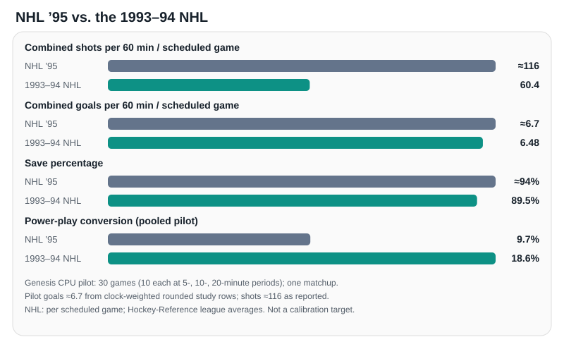
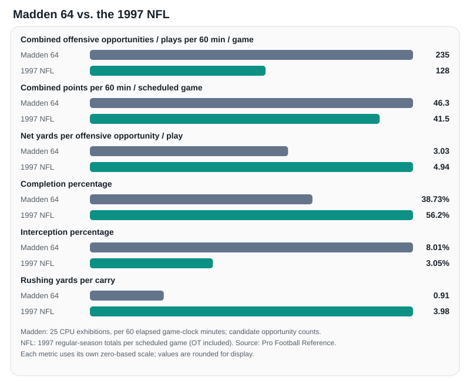

# Model comparison

[Evaluation](README.md) · [Registry](../model-cards/README.md)

Do not create a single leaderboard by mixing cohorts, targets, quote timing or seed counts. These are source-reported snapshots, not new reruns.

## Cross-model diagnosis: pace, efficiency and mechanism

Owner's working diagnosis (2026-11-26): the historical-row SLC models' primary problem is how plays/outcomes are sampled; V1 Complete's primary behavioral problem is how autonomous players perceive, decide and execute. CEG replaces historical-row dependence with fitted conditional event distributions, but remains subject to distribution, dependency and integration errors. These are not interchangeable with accelerated gameplay or inadequate compensation for acceleration. This is a research prioritization based on the evidence below, not a claim that every failure has been explained or that pace is already correct.

| System | Current diagnosis / hypothesis | Evidence and priority |
|---|---|---|
| NHL 95 (playable reference) | Prior project observation: elevated shot opportunities offset by effective goalies. | Illustrates pace/efficiency compensation; not independently quantified here. |
| Madden 64 (playable reference) | High offensive opportunity rate accompanied by suppressed offensive efficiency. Intentional compensation is a hypothesis, not established developer intent. | [25-game validation and NHL 95 analogy](https://github.com/micahp/legendarypicks/blob/3607143826f5ef2c55b52ee87a53366bdd1491c4/docs/research/MADDEN64-25-GAME-VALIDATION-AND-AI-INVESTIGATION-2026-11-26.md#accelerated-gameplay-and-scoring-compensation-nhl-95-analogy): 234.63 recorded offensive opportunities and 46.26 points per 60 elapsed game-clock minutes; 3.03 net yards/opportunity. One matchup, candidate event labels, whole-game totals. Historical NFL reference is per scheduled game, not elapsed-clock matched. |
| SLC V1, V1.5, V1.6, V1.7, V2 (historical-row models) | Historical play selection, event labels, conditioning, weighting and support can distort otherwise real football observations. | [SLC architecture](../architecture/SLC.md), [V2 conditioning arms](../model-cards/nfl/slc-v2-simplified.md#conditioning-methods-visual). Prioritize verifying the call/outcome/yardage and clock sampling paths, simplifying or removing unsupported conditioning, and matched controls; not arbitrary pace compensation. Individual variants address different subsets of the problem. |
| CEG (statistical generation without runtime historical-row sampling) | Fitted event probabilities, generated quantities and their joint dependencies may be inaccurate. | [CEG architecture and phase evidence](../architecture/CEG.md). Validate conditional and marginal distributions, support, opportunity allocation and event/clock/reducer interactions separately; no assumption that removing historical-row sampling solves realism. |
| V1 Complete (autonomous physical execution) | Player intelligence and execution: role/assignment logic, perception, decisions, movement, contact and possession transitions. Separately, full-game participation, special-teams and legal-state integration can prevent valid completion. | [Gridiron](../architecture/GRIDIRON.md), [Liquid AI audit and controlled replay evidence](../architecture/LIQUID-AI.md#critical-defects-and-evidence). Fix logical and integration defects first; no compensatory defensive strength, offensive suppression or clock manipulation to conceal them. |

The Madden analogy shows why plausible scoring alone is insufficient: high opportunity frequency can offset low points per opportunity. A playable retro game may deliberately trade realism of pace or efficiency for playability; a predictive NFL simulator must independently reproduce credible pace, outcome efficiency, scoring, player statistics and forecast probabilities. Madden is a mechanism reference, not a statistical calibration target. CEG does not execute physical player AI; V1 Complete uses typed CEG contracts for event transport, not its statistical outcome generator.

See [simulation learnings](../SIMULATION-LEARNINGS.md#retro-reference-pace-and-efficiency) for source and denominator limitations.

### Standard pace-versus-efficiency evaluation

For every NFL model evaluation, report the following separately on the same matched real-game cohort, using exact model/configuration pins, cutoff-valid inputs, and stable paired seed streams where available. This is a required reporting standard for future evaluations, not a claim that these metrics are currently emitted by every runner.

| Metric | Definition / diagnostic purpose |
|---|---|
| Live-ball duration | Snap or legal kick to whistle/dead ball, in elapsed game-clock seconds and, for physical engines, simulation seconds where available. Report distributions by event family; distinguish physical motion speed from clock behavior. |
| Dead-ball clock runoff | Game-clock seconds between dead ball and next snap/kick, accounting for stops, timeouts and quarter boundaries. Do not equate stopped-clock waiting with game-clock runoff. |
| Offensive plays per 60 minutes | Count accepted scrimmage plays under a documented NFL-compatible counting convention; separately record no-plays, sacks, kneels, spikes, special teams, drives, regulation and OT. Normalize pooled counts by actual elapsed game-clock minutes; do not mix per-team with combined-game rates or silently substitute candidate opportunities for official plays. |
| Per-play efficiency | Net yards/play, points/drive, offensive points/play, completion and interception rates, sacks/dropback, rushing yards/carry, turnovers and relevant player opportunity/production distributions. Also report total points/play with defense and special teams separated from offense. |

Use distributions as well as means; report denominators, missing/unmeasured metrics, blocked seeds and valid-completion coverage. Do not infer full-game pace from standalone plays or compare truncated games as complete games. Where comparable live/dead-ball timing ground truth is missing, label it explicitly; do not infer precise timing from aggregate counters. Preserve regulation/OT distinctions. Historical NFL is the calibration baseline; NHL/Madden evidence serves diagnostic analogy only.

**Decision rule:** (1) establish legal reproducible full-game execution and reconciled stats; (2) locate abnormal pace or efficiency by event/state/role and independently test clock/sampling/controller changes; (3) evaluate the matched pace and efficiency distributions without using one to cancel the other's error; (4) only then tune parameters and assess held-out forecasting skill against statistical and market baselines. If both axes are realistic but scoring remains wrong, inspect drive/turnover/scoring dependencies. If pace is wrong, fix clock or cadence; if efficiency is wrong, fix the sampling/generation or player execution mechanisms appropriate to that model. Do not add compensation merely to match total points. Preserve the standalone controller experiment separately from full-game integration acceptance.

## Week 11 2026: 13 games, 40 seeds per CEG game

[Phase 7 report](https://github.com/micahp/legendarypicks/blob/8d86d430/docs/research/slc-ceg-2026-11-24/PHASE7-EVALUATION-REPORT.md) identifies this examined cohort; lower is better.

| Model | Home-win Brier | Margin MAE | Total MAE |
|---|---:|---:|---:|
| Market | .183 | 7.8 | 10.8 |
| Frozen V2 | .205 | 9.9 | 12.3 |
| Frozen V1.6 (ALT - cond. pass lbl, xct dist + yrd, + sack suppress. fix) | .230 | 10.0 | 13.1 |
| CEG-SEL+E | .245 | 12.1 | 11.2 |
| Coin | .250 | — | — |

CEG realism (300 league-average games vs 2025): points 20.11 vs 23.01; plays 67.6 vs 65.9 (including no-play fouls); drives 20.7 vs 21.1/game. 300/300 realism and 1,160/1,160 forecast games reported complete; not comprehensive rule verification. Later Phase 9 held-out drive comparison did not establish a strength term beating CEG C. See [Phase 9](https://github.com/micahp/legendarypicks/blob/8d86d430/docs/research/slc-ceg-2026-11-24/PHASE9-TEAM-STRENGTH-REPORT.md).

## Other evidence

- [NFL model card](../model-cards/nfl.md) contains separate 2025 game baseline and player-prop experiments; do not compare directly to the table above.
- [V1 Complete passing audit](https://github.com/micahp/legendarypicks/blob/50c15508/docs/research/V1-COMPLETE-LIQUID-AI-ARCHITECTURE-AUDIT-2026-11-26.md): controlled mechanism diagnosis, not full-game forecast.
- [Portable pack evidence](https://github.com/micahp/legendarypicks/blob/e0d3f603/docs/research/SLC-PORTABLE-MODEL-PACK-2026-11-18.md): smoke/parity, not accuracy.
- Other weekly grade results must be added from exact archived grading artifacts, with denominators and model pins verified. No claim that this page includes every historic result.
