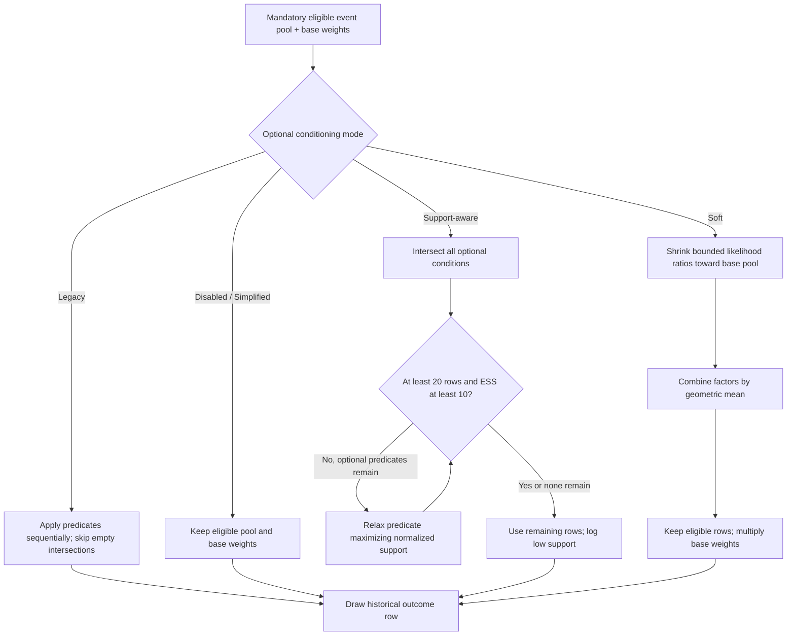

# SLC V2 Simplified and conditioning arms

[Registry](README.md) · [SLC](../../architecture/SLC.md)

Research pin `41a759e3`, [conditioning implementation](https://github.com/micahp/legendarypicks/blob/41a759e3/scripts/nfl_sequence/slc_playcall.py#L766-L845). Same historical PlayCallSampler execution, with optional row conditioning mode disabled (Simplified), support-aware, or soft; legacy preserves original sequential filters. Disabled skips optional formation, coverage, streak, label, target role and exact-spot row filters, not necessarily upstream event-probability adjustments. Support-aware/soft retain optional conditioning differently; inspect [helper](https://github.com/micahp/legendarypicks/blob/41a759e3/scripts/nfl_sequence/slc_row_conditioning.py) and exact configuration. Not V2 Pure. No matched held-out results independently recovered here; no promotion. Reconcile with newer V2 personnel-first changes before integration.

## Conditioning methods (visual)

Support-aware checks both raw support and Kish effective sample size (ESS); the normalized relaxation score is the smaller of count/20 and ESS/10. If the eligible pool itself is insufficient, the algorithm relaxes all optional conditions and records the failure, not fake support. Soft defaults at the reviewed pin: ratio cap 4, shrinkage prior 25, unsupported conditions skipped, no optional hard exclusion. Legacy is order dependent: an earlier nonempty filter can prevent a later condition from ever applying. Simplified removes optional row filters, not mandatory event compatibility, cutoff, roster or legality constraints. These defaults describe [slc_row_conditioning.py at 41a759e3](https://github.com/micahp/legendarypicks/blob/41a759e3/scripts/nfl_sequence/slc_row_conditioning.py), not an adopted package.

### What to measure

Compare identical frozen input snapshots and seeds; measure candidate count, ESS, maximum weight share, order dependence, blocked seeds, football realism and out-of-sample Brier. A wider pool or fewer blocked seeds is not necessarily better predictive performance. CEG is a separate conditional generator, not a fifth row-filter mode.
