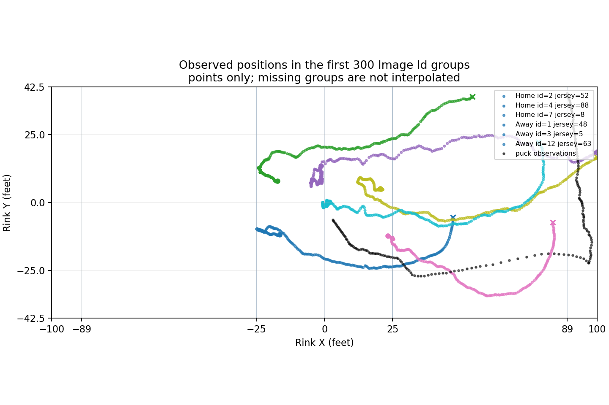
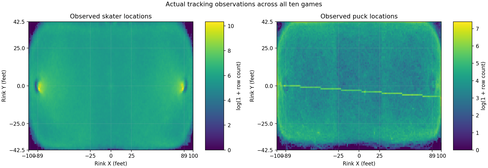
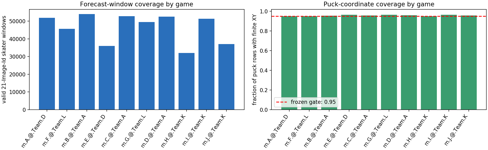

# NHL ten-game movement and kinematics study

**Branch:** `research/nhl-ten-game-kinematics-2026-10-22`

**Study base:** `25d1c746f714d89cbaf2561d4d25035c0fb4b33a`
**Scope:** research only. No production simulator or forecast changes.

## Decision

The release supports a large, measurable **ordered-observation skater-path** experiment. It does
not yet support claims about elapsed-time movement, individual athlete ability, shot-to-rebound
physics, or goalie response.

In leave-one-game-out development predictions, the learned kinematic correction lowered equal-game
mean position error by **0.301 ft** versus constant velocity. The empirical constraint projection
lowered it by a further **0.020 ft**. The paired ten-game bootstrap intervals exclude zero for both
comparisons, but these are development-set intervals from only ten inspected games, not an
independent adoption test. The larger gain came from learning short-horizon motion patterns; the
extra constraint gain is small and is not evidence that collision or other physical modeling adds
value.

**Recommendation:** proceed only to a separately frozen evaluation on independent games with a
documented subsecond timebase and verified identities. Do not use these results to adopt a game
simulator, claim validated physics, or integrate player-specific ratings. All ten games here are
development data.

## Data, gates, and eligibility

The local release manifest listed 54 assets totaling 674,203,388 bytes. All sizes and SHA-256 hashes
matched. The release contains ten anonymized games, 30 regulation tracking files, and three OT
files. Raw source files remained outside the repository.

| Component | Frozen requirement | Full-population observation | Result and consequence |
|---|---|---|---|
| Release integrity | 54 assets match manifest sizes and hashes | 54/54 verified | Pass |
| XY tracking | At least 99% finite, in-rink player/puck coordinates | 8,355,303 / 8,401,602 rows; **99.449%**. The 46,299 missing-coordinate rows are counted; all finite points were in the documented rink bounds. | Pass; windows crossing a missing point were discarded |
| Image Id order | Unique, increasing numeric suffixes within each file | No duplicate or reversed suffixes; **793 suffix gaps** over 959,754 Image Id groups | Pass for ordering; gaps reset trajectory windows |
| Game-clock completeness | At least 99% of rows and Image Id groups have a clock | **99.892%** of rows and **99.885%** of groups; 9,075 missing-clock rows and 1,102 groups | Pass for coverage; blank clocks were not imputed |
| Timebase | A documented capture rate or subsecond timestamp | Neither is published. There were **27 game-clock reversals**. Numeric suffix/game-clock ratios ranged from 44.79 to 76.33 per clock second, which is not a camera frame-rate measurement. | Fail/unavailable for seconds-based modeling; use suffix increments only |
| Player identity | ≥90% ID+jersey coverage, ≥90% shift-roster match, <0.1% conflicting track mappings, no duplicate IDs per group | ID+jersey **99.365%**; shift-roster match **98.830%**; 292 conflicts / 32,312 track-period IDs (**0.904%**); zero duplicate IDs within a group | Composite gate fails. All windows from each conflicted track-period ID were quarantined |
| Puck frame/coordinate coverage | ≥99% one puck row/group, ≥95% finite puck XY, ≥10,000 continuous windows in at least 8 games | One puck row in **100%** of groups; **95.744%** finite puck XY; **60,368** uninterrupted 21-Image-Id windows | Pass for sequence and coordinate coverage. The frozen 100ms gap criterion is **not assessable** without a timebase |
| Skater window coverage | ≥10,000 overall and ≥1,000 in at least 8 games | **462,680** raw windows; after identity quarantine, **454,983** remain, with **31,851–53,391** per game | Pass after quarantine in all ten games |
| Event-to-track alignment | ≥100 matches and direct-map median ≤20 ft, p95 ≤40 ft in at least 8 games | 15,503 actor/clock matches. Game medians ranged 4.03–8.90 ft, but only **4/10** games met the p95 limit; the worst per-game/file p95 was 180.26 ft. | Fail; event coordinates and all event/outcome features were quarantined from movement models |

The first proposed 25–32 frames/s criterion was not supportable from the published fields. The
release defines Image Id as an identifier and Game Clock at whole-second precision; it does not
document capture cadence. I retained the measured numeric-suffix/game-clock ratio as a diagnostic,
not as FPS. The prediction horizon below is therefore **15 numeric Image Id suffix increments**,
with no conversion to seconds. This terminology correction changed no examples, model, or scores.
The `timebase_assessment` block is emitted by `audit_tracking_quality.py` from its computed Image Id
ordering, documented-timebase, and puck-continuity gates.

The frozen gate table and full raw metrics are in
[NHL-TEN-GAME-KINEMATICS-GATES-2026-10-22.md](NHL-TEN-GAME-KINEMATICS-GATES-2026-10-22.md).

## Observed movement

Plots use observed points only; no missing positions are interpolated.







These plots verify visible 2D trajectories and broad rink coverage. They do not validate optical
measurement error, elapsed time, or physical contact.

## Controlled candidate comparison

The committed protocol uses six consecutive observed XY positions to predict the same track at
`t+15` suffix increments. Every candidate used the same **454,983 eligible windows** and the same
ten leave-one-game-out folds. Training, calibration, and scoring were grouped by whole game. The
ridge penalty and constraint quantiles were fixed before fitting; no holdout results were used to
tune them.

Equal-game-weighted out-of-fold results:

| Candidate | Mean position error (ft) | Median (ft) | P90 (ft) | Mean heading error (degrees) | Displacement-magnitude error (ft per 15 suffix increments) | 90% radius coverage |
|---|---:|---:|---:|---:|---:|---:|
| Constant velocity | 3.523 | 3.016 | 6.749 | 31.118 | 1.702 | 89.76% |
| Learned kinematic correction | 3.222 | 2.835 | 6.033 | 30.099 | 1.723 | 89.76% |
| Constrained kinematic prediction | **3.202** | **2.820** | **5.991** | **29.978** | 1.716 | 89.76% |

Paired difference is left candidate minus right candidate; negative error is better. Intervals are
95% percentile intervals from 10,000 paired bootstrap replicates over the ten held-out game scores
(seed `20261022`).

| Comparison | Mean position error delta (ft), 95% interval | P90 position error delta (ft), 95% interval | Interpretation |
|---|---:|---:|---|
| Learned − constant velocity | −0.301 [−0.325, −0.278] | −0.716 [−0.765, −0.670] | Improvement appeared in all 10 development games |
| Constrained − learned | −0.020 [−0.023, −0.018] | −0.042 [−0.049, −0.037] | Small additional improvement appeared in all 10 games |
| Constrained − constant velocity | −0.321 [−0.347, −0.297] | −0.758 [−0.810, −0.709] | Best development score, with no independent evaluation |

The learned and constrained models improved heading error, but neither improved displacement-
magnitude error against constant velocity in a statistically clear way (learned delta +0.022 ft,
95% interval [−0.010, +0.050]; constrained delta +0.015 ft, [−0.017, +0.043]). The 90% radius
coverage was about 89.76% for each candidate; average calibrated radii were 6.750, 6.033, and 5.991
ft, respectively. Calibration used one of the nine training games in each fold, so these intervals
are descriptive rather than population guarantees.

**Physical-model arm disposition:** the gates do not permit a genuine time-calibrated constrained
physical candidate. Image Id is only an ordinal, and the release lacks validated identity continuity,
tracking-error ground truth, and contact/reachability labels. The third candidate is only a
training-bounded kinematic feasibility projection with rink clipping. It tests the effect of those
simple constraints on endpoint prediction; it does not test whether collision, reachability, or
other physical interactions add predictive value. Under the amended comparison, that physical arm
remains unrun pending data that pass the relevant gates.

The game-cluster intervals quantify variation across these ten fixed development predictions. They
do not include uncertainty from collecting new games or fully account for overlapping outer-fold
training sets. Treat the apparent statistical separation as promising within-sample evidence, not
confirmation for deployment.

### Player-specific movement estimates

No track-period entity met the preregistered joint requirement of 3,000 valid observed Image Id
groups and 100 eligible movement windows in each chronological half. Consequently there are no
reportable split-half estimates for individual speed proxies, acceleration proxies, or turning
stability. Reaction ability is unmeasurable because no subsecond stimulus/onset labels exist. The
release's `Player Id` is retained only as a game/period-scoped tracking identity; it is not merged
across games or treated as a verified athlete identity.

Individual movement profiles are not estimable from this release because track-period IDs are
short-lived: the median profile spans 172 Image Id groups, and only 1 of 28,723 profiles reaches
3,000 groups. That profile has 0 eligible windows before and 298 after its period-file midpoint, so
it never spans the split needed for a two-half estimate; this is a property of the observed data,
not a consequence of choosing the 3,000-group threshold.

## Adequacy for the requested hockey mechanisms

| Mechanism | Available evidence | Missing evidence and status |
|---|---|---|
| Skater movement | Dense 2D rink XY sequences, mostly valid jersey joins, and 454,983 clean short-horizon examples | No documented subsecond capture time; some track IDs change jersey; no tracking-error ground truth. Adequate for a fixed-observation-index path study, not athlete skill or real-time kinematics |
| Goalie response | Player/puck XY observations and shift roster joins | No verified goalie-role label in the tracking schema, no body/pose/facing/stick state, no subsecond shot-release and save-contact times, and no goalie reaction labels. Not adequate |
| Shot trajectory | Event rows label shot type, release location, and whether the attempt was on-net, missed, or blocked; puck has 2D XY observations | Event alignment gate fails; no validated release frame or continuous shot-linked puck path. Puck Z is a placeholder except around goals. Not adequate for flight or save physics |
| Rebound | Shot outcomes and general puck-recovery events are represented in the event log | No explicit shot-linked save/rebound label, goalie freeze/deflection, first post-contact puck state, or subsecond recovery sequence. Not adequate |
| Possession | Puck positions and discrete plays/recoveries | No continuous carrier/control label, stick contact, possession intervals, or possession uncertainty. Nearest-player proximity would be an unvalidated proxy. Not adequate |

The official [data dictionary](https://github.com/bigdatacup/Big-Data-Cup-2026) describes shots, goals,
recoveries, and tracking fields. Its legal terms say research may be shared publicly only when it is
not used for profit ([Stathletes Public Data User Agreement](https://github.com/bigdatacup/Big-Data-Cup-2026/blob/main/legal.md)). This work remains local and research-only; commercial reuse or integration requires separately verified rights. No provider was contacted and no raw source asset was added to the repository.

## Future simulator interface (specification only)

No generator was implemented. A future predictive play generator would need this explicit contract:

| Interface part | Required contents | Current release support |
|---|---|---|
| Initial state | Game/period, observation index and validated timestamp, rink orientation, score/clock, all player and puck positions, missingness and state uncertainty | 2D locations and game/period exist; physical timestamp is unavailable, event clock is coarse, and event coordinates are quarantined |
| Player attributes | Verified roster identity/role, handedness and position where relevant, plus calibrated per-player movement distributions | Game-scoped track ID and jersey only; no reliable individual movement profiles or cross-game identity |
| Action/policy inputs | A pregame/current-state policy distribution for skating, passing, shooting, coverage, and goalie actions | Not supplied by the tracking release; must be learned without future outcomes |
| Physical constraints | Rink bounds, time-calibrated speed/acceleration, player reach/contact, stick and puck interactions, goalie reach and puck flight | Only rink bounds and empirical per-Image-Id movement limits were tested; collision, reachability, and puck physics are unvalidated |
| Stochastic outputs | Joint player/puck trajectories, event transitions, outcome probabilities, and calibrated uncertainty | This experiment emits deterministic skater endpoints with calibrated radial error only; it does not generate plays or outcomes |
| Eligibility/failure | Mark state unknown and suppress predictions after identity conflict, missing coordinates, index gap, or unsupported component | Windows reset or the full conflicted track-period identity is excluded; missing values are not imputed |

## Artifact provenance

`audit_tracking_quality.py` now emits the complete quality JSON, including the frozen historical
gate snapshot. The repository regeneration command was:

```bash
OPENBLAS_NUM_THREADS=1 OMP_NUM_THREADS=1 MKL_NUM_THREADS=1 \
  python3 research/nhl-ten-game-kinematics-2026-10-22/audit_tracking_quality.py \
  --output-dir research/nhl-ten-game-kinematics-2026-10-22/quality
```

It exited **1** on the unchanged frozen gates: `documented_subsecond_timebase`,
`event_coordinate_alignment`, `game_clock_monotonicity`,
`initial_25_32_image_id_clock_proxy_check`, and `player_identity_coverage` are false;
`puck_100ms_time_continuity` is null. This disposition matches the committed artifact. Comparing
JSON leaves with `git show 7b57bd24:research/nhl-ten-game-kinematics-2026-10-22/quality/tracking_quality.json`
found only `runtime_seconds` different (411.37 committed; 404.171 regenerated).

A second run with the same command and `--output-dir /tmp/nhl-quality-provenance-v4-scratch` also
exited 1 on the same gates. Its JSON differs from the repository output only in `runtime_seconds`
(388.693). `tracking_quality_by_game.csv` remains byte-identical to the base commit
(SHA-256 `b629324a7483b5f169fa25c320f2748ebbe557d2b28862756bf48302cdff43df`).
`results/kinematics_model_comparison.json` remains unchanged at SHA-256
`f20055472b49f9d8afb8d5bd8dbf81b88b59e2483f3516e1df65f650b15be27c`; the model fit was not rerun.
Both audit runs used one numerical-library thread. `py_compile` for the audit and fit scripts and
`git diff --check` passed.

## Runtime, artifacts, and validation

- Full quality audit: **411.37 s** for manifest verification, sequential scan of 33 tracking files,
  aggregate checks, and visualizations.
- Model pass: **298.95 s** for a second manifest verification, sequential feature extraction,
  identity quarantine, ten folds, prediction intervals, and scoring. Numerical libraries were
  restricted to one thread. Comparisons used common deterministic windows; there was no repeated
  Monte Carlo trajectory generation.
- The single-period extraction smoke reconciled all **18,525** windows and quarantined **436** from
  15 conflicting IDs before the full model pass. The full pass reconciled all 33 file window and
  conflict counts against the quality audit.
- Python syntax compilation and `git diff --check` passed. No production tests or simulator changes
  were made.

Artifacts are stored under
[`research/nhl-ten-game-kinematics-2026-10-22/`](../../research/nhl-ten-game-kinematics-2026-10-22/):

- [Full quality metrics](../../research/nhl-ten-game-kinematics-2026-10-22/quality/tracking_quality.json)
- [Quality by game](../../research/nhl-ten-game-kinematics-2026-10-22/quality/tracking_quality_by_game.csv)
- [Candidate metrics and bootstrap intervals](../../research/nhl-ten-game-kinematics-2026-10-22/results/kinematics_model_comparison.json)
- [Candidate scores by game](../../research/nhl-ten-game-kinematics-2026-10-22/results/kinematics_scores_by_game.csv)
- [Frozen prediction protocol](NHL-TEN-GAME-KINEMATICS-PREDICTION-PROTOCOL-2026-10-22.md)
