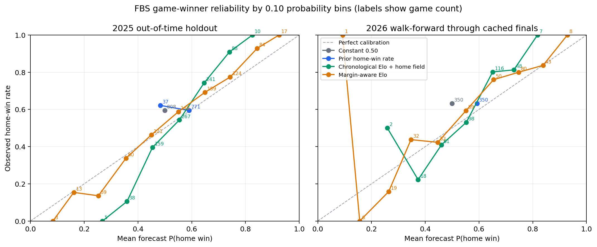

# FBS Game-Winner Baseline Results — Phase 1

Generated: 2026-10-18 09:15:36 UTC  
Branch: `feat/fbs-data-audit`  
Model version: `fbs-game-winner-g0-g3-v1-20261017`

## Scope and result

This run evaluates G0–G3 on every completed FBS-vs-FBS game available in the local 2022–2026 schedule releases. It uses no player, player-prop, box-score, play-by-play, market, or same-game outcome features. Every model receives a forecast for the same game rows. The earlier `REPORT-FBS-GAME-WINNER-BASELINE-20261017.md` is preserved as a separate prior run; its three-model, 2023+ results are not substituted for this revised ladder.

2025 is the out-of-time holdout year for model selection: constants are fixed in code and were not tuned on any evaluation year. It is evaluated walk-forward, so earlier completed 2025 games can inform later 2025 forecasts after the 24-hour lag, but no game's result informs its own forecast. For every game, history contains only completed eligible games whose kickoff was strictly more than 24 hours before the target kickoff. The source files do not publish final-whistle timestamps, so the ledger proves the kickoff-time cutoff; it cannot verify each historical result's exact publication timestamp.

2026 is a separate walk-forward evaluation through the completed games present in the cached schedule snapshot. Later 2026 games absent or unfinished in that snapshot are not evaluated. FBS-vs-FCS games are excluded from both evaluation and rating updates.

| Population measure | Value |
|---|---:|
| Eligible completed FBS-vs-FBS games | 3524 |
| Evaluated seasons | 2022–2026 |
| Home-site games | 3280 |
| Neutral-site games | 244 |
| Additional games with a previously seen identical kickoff timestamp | 2053 |
| Eligible rows without a resolved stable team ID | 0 |
| `fbs_game` vs known home/away division membership disagreements | 0 |
| `fbs_participant` vs known home/away division membership disagreements | 0 |
| Excluded completed FBS-vs-FBS rows with unresolved team IDs | 0 |
| Duplicate schedule/ESPN rows excluded | 0 |
| Duplicate game IDs in the forecast ledger | 0 |
| Cross-season duplicate completed FBS-participant rows excluded | 0 |

Eligible games by season: 2022: 776, 2023: 792, 2024: 798, 2025: 808, 2026: 350. Every same-timestamp group is forecast before any result from that group can update a rating.

## Population coverage and exclusions

| Season | Scheduled FBS-vs-FBS | Completed eligible | Completed FBS-vs-FCS excluded | Not final | In progress | Canceled | No ESPN schedule row | FBS-vs-FBS unresolved IDs excluded | Duplicate schedule/ESPN rows | CFBD score pairs checked / agree |
|---:|---:|---:|---:|---:|---:|---:|---:|---:|---:|---:|
| 2022 | 776 | 776 | 120 | 0 | 0 | 0 | 0 | 0 | 0 | 776 / 776 |
| 2023 | 792 | 792 | 118 | 0 | 0 | 0 | 0 | 0 | 0 | 792 / 792 |
| 2024 | 799 | 798 | 121 | 1 | 0 | 1 | 0 | 0 | 0 | 798 / 798 |
| 2025 | 808 | 808 | 126 | 0 | 0 | 0 | 0 | 0 | 0 | 808 / 808 |
| 2026 | 761 | 350 | 121 | 411 | 15 | 0 | 396 | 0 | 0 | 339 / 339 |

The primary membership flag is the season-specific `fbs_game` field in `cfb_schedules`; each ledger row also carries explicit home and away FBS membership booleans. The source loader compares the published FBS game/participant flags with the two season-specific division fields where both are known; disagreement counts are above and in the eligibility CSV. FBS-participant games are separately counted to identify completed FBS-vs-FCS exclusions. ESPN schedule rows supply kickoff, home/away orientation, `STATUS_FINAL`, and final scores. The loader excludes duplicate source IDs, unresolved team identities, tied outcomes, and missing-kickoff rows; team-identity or score conflicts fail the run. The table counts final-score cross-checks where both the CFBD schedule and ESPN schedule provide scores; all checked pairs agree. In 2026, 11 ESPN-final FBS-vs-FBS rows were not yet marked completed by the CFBD schedule release and are included from ESPN's final status and score.

2024's one canceled FBS-vs-FBS fixture has a 0–0 placeholder and is excluded because both schedule sources mark it canceled. The 2026 cached release has 15 FBS-vs-FBS games marked in progress and 396 scheduled FBS-vs-FBS rows with no matching ESPN schedule event; all 411 are non-final and excluded. The schedule source does not distinguish the future/no-ESPN rows from other absent event IDs, so they are reported as that measured category rather than inferred to be completed or canceled.

## Model definitions

| Model | Definition |
|---|---|
| G0 | Fixed P(home wins) = 0.50 for every game. Its one-outcome Brier is exactly 0.2500 on binary outcomes. |
| G1 | Expanding prior home-win rate over earlier eligible FBS-vs-FBS games, split between neutral and home-site games, with Beta(1,1) smoothing. |
| G2 | Elo ratings start at 1500; logistic scale 400; K=20; fixed home advantage 55 rating points (0 at neutral); 25% regression toward 1500 when a new season begins. |
| G3 | Same pregame Elo probability and season handling as G2, but rating updates use score margin: K multiplier = ln(1 + absolute margin) × 2.2 / (2.2 + 0.001 × absolute pregame Elo gap). |

G0–G3 use only completed FBS-vs-FBS outcomes and margins from the local archive. The model constants are fixed, not fitted. All games with an identical kickoff timestamp are predicted before any of their results are applied. A neutral-site game receives no Elo home-field points; G1 uses its separate neutral-site prior.

## Pooled walk-forward results

| Model | Games | Brier | Coin-flip BSS | Log loss | Accuracy | Mean P(home) | Home win rate | Reliability | Resolution |
|---|---:|---:|---:|---:|---:|---:|---:|---:|---:|
| Constant 0.50 | 3524 | 0.2500 | 0.0000 | 0.6931 | 0.5880 | 0.5000 | 0.5880 | 0.0077 | 0.0000 |
| Prior home-win rate | 3524 | 0.2430 | 0.0279 | 0.6792 | 0.5851 | 0.5903 | 0.5880 | 0.0007 | 0.0002 |
| Chronological Elo + home field | 3524 | 0.2163 | 0.1346 | 0.6229 | 0.6592 | 0.5773 | 0.5880 | 0.0087 | 0.0327 |
| Margin-aware Elo | 3524 | 0.2002 | 0.1992 | 0.5849 | 0.6901 | 0.5782 | 0.5880 | 0.0022 | 0.0432 |

Brier uses one binary outcome per game: `(P(home win) − y)^2`, where y=1 only when the home-designated team wins. Lower is better. Coin-flip BSS is `1 − Brier/0.25`. Reliability and resolution are the fixed 10-bin Murphy decomposition components and therefore are binned approximations. Calibration is also reported as mean forecast against the observed home-win rate.

## Season-by-season results

### 2022 — chronological development years

| Model | Games | Brier | Coin-flip BSS | Log loss | Accuracy | Mean P(home) | Home win rate | Reliability | Resolution |
|---|---:|---:|---:|---:|---:|---:|---:|---:|---:|
| Constant 0.50 | 776 | 0.2500 | 0.0000 | 0.6931 | 0.5760 | 0.5000 | 0.5760 | 0.0058 | 0.0000 |
| Prior home-win rate | 776 | 0.2479 | 0.0086 | 0.6893 | 0.5760 | 0.6151 | 0.5760 | 0.0025 | 0.0002 |
| Chronological Elo + home field | 776 | 0.2312 | 0.0754 | 0.6547 | 0.6263 | 0.5756 | 0.5760 | 0.0098 | 0.0201 |
| Margin-aware Elo | 776 | 0.2168 | 0.1330 | 0.6240 | 0.6546 | 0.5771 | 0.5760 | 0.0075 | 0.0325 |

### 2023 — chronological development years

| Model | Games | Brier | Coin-flip BSS | Log loss | Accuracy | Mean P(home) | Home win rate | Reliability | Resolution |
|---|---:|---:|---:|---:|---:|---:|---:|---:|---:|
| Constant 0.50 | 792 | 0.2500 | 0.0000 | 0.6931 | 0.5795 | 0.5000 | 0.5795 | 0.0063 | 0.0000 |
| Prior home-win rate | 792 | 0.2441 | 0.0238 | 0.6812 | 0.5745 | 0.5816 | 0.5795 | 0.0004 | 0.0002 |
| Chronological Elo + home field | 792 | 0.2137 | 0.1451 | 0.6179 | 0.6780 | 0.5750 | 0.5795 | 0.0143 | 0.0418 |
| Margin-aware Elo | 792 | 0.1934 | 0.2263 | 0.5711 | 0.7222 | 0.5733 | 0.5795 | 0.0053 | 0.0554 |

### 2024 — chronological development years

| Model | Games | Brier | Coin-flip BSS | Log loss | Accuracy | Mean P(home) | Home win rate | Reliability | Resolution |
|---|---:|---:|---:|---:|---:|---:|---:|---:|---:|
| Constant 0.50 | 798 | 0.2500 | 0.0000 | 0.6931 | 0.5815 | 0.5000 | 0.5815 | 0.0066 | 0.0000 |
| Prior home-win rate | 798 | 0.2421 | 0.0317 | 0.6772 | 0.5852 | 0.5789 | 0.5815 | 0.0000 | 0.0008 |
| Chronological Elo + home field | 798 | 0.2180 | 0.1281 | 0.6256 | 0.6378 | 0.5791 | 0.5815 | 0.0076 | 0.0322 |
| Margin-aware Elo | 798 | 0.2036 | 0.1854 | 0.5905 | 0.6642 | 0.5806 | 0.5815 | 0.0022 | 0.0413 |

### 2025 — out-of-time holdout

| Model | Games | Brier | Coin-flip BSS | Log loss | Accuracy | Mean P(home) | Home win rate | Reliability | Resolution |
|---|---:|---:|---:|---:|---:|---:|---:|---:|---:|
| Constant 0.50 | 808 | 0.2500 | 0.0000 | 0.6931 | 0.5953 | 0.5000 | 0.5953 | 0.0091 | 0.0000 |
| Prior home-win rate | 808 | 0.2420 | 0.0322 | 0.6770 | 0.5842 | 0.5854 | 0.5953 | 0.0009 | 0.0000 |
| Chronological Elo + home field | 808 | 0.2080 | 0.1679 | 0.6048 | 0.6795 | 0.5746 | 0.5953 | 0.0104 | 0.0414 |
| Margin-aware Elo | 808 | 0.1912 | 0.2351 | 0.5630 | 0.7067 | 0.5735 | 0.5953 | 0.0027 | 0.0508 |

### 2026 — walk-forward

| Model | Games | Brier | Coin-flip BSS | Log loss | Accuracy | Mean P(home) | Home win rate | Reliability | Resolution |
|---|---:|---:|---:|---:|---:|---:|---:|---:|---:|
| Constant 0.50 | 350 | 0.2500 | 0.0000 | 0.6931 | 0.6314 | 0.5000 | 0.6314 | 0.0173 | 0.0000 |
| Prior home-win rate | 350 | 0.2346 | 0.0616 | 0.6621 | 0.6314 | 0.5924 | 0.6314 | 0.0015 | 0.0000 |
| Chronological Elo + home field | 350 | 0.2049 | 0.1802 | 0.5990 | 0.6914 | 0.5878 | 0.6314 | 0.0112 | 0.0369 |
| Margin-aware Elo | 350 | 0.1917 | 0.2332 | 0.5667 | 0.7171 | 0.5970 | 0.6314 | 0.0068 | 0.0467 |

Week-level scores for every season and model are in [fbs_game_winner_weekly_metrics_20261017.csv](fbs_game_winner_weekly_metrics_20261017.csv). Weeks are Monday-starting UTC calendar weeks derived from the actual ESPN kickoff timestamp. The per-game ledger includes `week_start_utc` for consistent breakdowns.

## Paired uncertainty and rung comparisons

Intervals are 95% percentile intervals from 2000 paired, season-stratified UTC calendar-week block bootstrap replicates. Each sampled block carries all its games, preserving pairing between the compared forecasts. Blocks are resampled within season for the pooled result. This captures within-week dependence better than resampling individual games, though repeated-team dependence across weeks remains.

### All eligible games

| Candidate vs control | Games | Δ Brier (candidate − control) | 95% time-block interval |
|---|---:|---:|---:|
| G1 vs G0 | 3524 | -0.0070 | [-0.0106, -0.0033] |
| G2 vs G0 | 3524 | -0.0337 | [-0.0371, -0.0304] |
| G2 vs G1 | 3524 | -0.0267 | [-0.0302, -0.0234] |
| G3 vs G0 | 3524 | -0.0498 | [-0.0547, -0.0445] |
| G3 vs G1 | 3524 | -0.0428 | [-0.0483, -0.0371] |
| G3 vs G2 | 3524 | -0.0161 | [-0.0186, -0.0137] |

### 2025 holdout

| Candidate vs control | Games | Δ Brier (candidate − control) | 95% time-block interval |
|---|---:|---:|---:|
| G1 vs G0 | 808 | -0.0080 | [-0.0154, -0.0003] |
| G2 vs G0 | 808 | -0.0420 | [-0.0479, -0.0354] |
| G2 vs G1 | 808 | -0.0339 | [-0.0424, -0.0257] |
| G3 vs G0 | 808 | -0.0588 | [-0.0673, -0.0490] |
| G3 vs G1 | 808 | -0.0507 | [-0.0630, -0.0385] |
| G3 vs G2 | 808 | -0.0168 | [-0.0217, -0.0119] |

### 2026 walk-forward

| Candidate vs control | Games | Δ Brier (candidate − control) | 95% time-block interval |
|---|---:|---:|---:|
| G1 vs G0 | 350 | -0.0154 | [-0.0311, -0.0024] |
| G2 vs G0 | 350 | -0.0451 | [-0.0622, -0.0301] |
| G2 vs G1 | 350 | -0.0297 | [-0.0366, -0.0205] |
| G3 vs G0 | 350 | -0.0583 | [-0.0827, -0.0369] |
| G3 vs G1 | 350 | -0.0429 | [-0.0564, -0.0261] |
| G3 vs G2 | 350 | -0.0132 | [-0.0208, -0.0050] |

All season-specific paired intervals are in [fbs_game_winner_paired_20261017.csv](fbs_game_winner_paired_20261017.csv). Negative Δ Brier favors the candidate rung.

## Calibration

The reliability plot shows 2025 and 2026 separately; each point is a non-empty 0.10 probability bin and its label is the number of games in that bin. Detailed bin counts and observed rates for each model, each season, and the pooled sample are in [fbs_game_winner_calibration_20261017.csv](fbs_game_winner_calibration_20261017.csv).



## Market reference availability

The cached game-level betting files were inspected separately. Their columns contain game spread, total, home-favorite flag, and source, but no two-sided moneylines or odds timestamps. Only 2025 and 2026 betting files are present; they do not provide an earlier-season spread-to-probability calibration set for 2025. Since the snapshots' pre-kickoff timing cannot be verified, no market probability is scored and no spread-implied probability is substituted.

| Season | Eligible games | Matched spread rows | Non-null spreads | Moneyline fields | Timestamp fields |
|---:|---:|---:|---:|---|---|
| 2025 | 808 | 808 | 808 | none | none |
| 2026 | 350 | 336 | 336 | none | none |

## Keep/reject recommendation

**Keep G3 as the lead reference for the next phase.** It improves paired Brier with a week-block interval below zero and no increase in 10-bin reliability error in both the 2025 holdout and 2026 walk-forward sample. This is a result-only baseline decision, not evidence of market competitiveness.

This recommendation applies only to the game-winner baseline ladder. It does not authorize or start Phase 2.

## Reproduction and artifacts

Run from the repo root with the existing backend environment:

```bash
/root/legendarypicks/backend/venv/bin/python backend/fbs_game_winner_phase1.py
```

Source file paths, byte sizes, and SHA-256 hashes are in [fbs_game_winner_sources_20261017.csv](fbs_game_winner_sources_20261017.csv). The source releases used are listed below:

- `cfb_schedules_2022.parquet`
- `espn_schedule_2022.parquet`
- `cfb_team_info_2022.parquet`
- `cfb_schedules_2023.parquet`
- `espn_schedule_2023.parquet`
- `cfb_team_info_2023.parquet`
- `cfb_schedules_2024.parquet`
- `espn_schedule_2024.parquet`
- `cfb_team_info_2024.parquet`
- `cfb_schedules_2025.parquet`
- `espn_schedule_2025.parquet`
- `cfb_team_info_2025.parquet`
- `cfb_schedules_2026_snapshot_20261017.parquet`
- `espn_schedule_2026.parquet`
- `cfb_team_info_2026.parquet`

| Artifact | Purpose |
|---|---|
| [fbs_game_winner_forecasts_20261017.csv](fbs_game_winner_forecasts_20261017.csv) | One pregame forecast row for every eligible completed FBS-vs-FBS game; includes as-of cutoff, source IDs, result, and G0–G3 probabilities. |
| [fbs_game_winner_metrics_20261017.csv](fbs_game_winner_metrics_20261017.csv) | Season and pooled scoring metrics. |
| [fbs_game_winner_paired_20261017.csv](fbs_game_winner_paired_20261017.csv) | Paired week-block bootstrap intervals by season and pooled period. |
| [fbs_game_winner_calibration_20261017.csv](fbs_game_winner_calibration_20261017.csv) | Reliability-bin counts and observed rates. |
| [fbs_game_winner_weekly_metrics_20261017.csv](fbs_game_winner_weekly_metrics_20261017.csv) | Monday-starting UTC calendar-week scores. |
| [fbs_game_winner_eligibility_20261017.csv](fbs_game_winner_eligibility_20261017.csv) | Eligibility, exclusion, source reconciliation, and home/neutral coverage. |
| [fbs_game_winner_sources_20261017.csv](fbs_game_winner_sources_20261017.csv) | Input file manifest with SHA-256 and byte sizes. |
| [fbs_game_winner_calibration_20261017.png](fbs_game_winner_calibration_20261017.png) | Standalone 2025/2026 reliability plot. |
