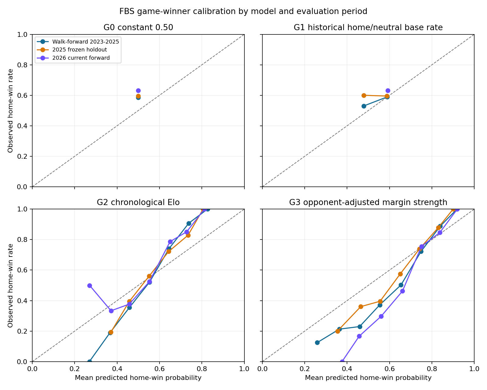

# FBS game-winner benchmark — Phase 1

Generated: 2026-10-18 09:15 UTC
Model version: `fbs-game-winner-baselines-v2-20261018`
Execution brief: `research/fbs/AUDIT-FBS-BASELINE-20261017.md` (current brief at file top)

## Result

This reproducible benchmark forecasts P(home-designated FBS team wins). It uses only prior completed game results and score margins; no player props, player statistics, box scores, play-by-play, sportsbook prices, or same-day results enter the forecasts. The primary ledger has one row per eligible FBS-FBS game. 2022 warms the models; chronological evaluation covers 2023-2026, with 2025 also reported as a frozen season holdout trained only through 2024.

| Evaluation period | Model | Games | Brier | Coinflip BSS | Log loss | Accuracy | Mean forecast / outcome rate | Reliability (10 bins) | Resolution (10 bins) |
|---|---|---|---|---|---|---|---|---|---|
| Walk-forward 2023-2025 | G0 constant 0.50 | 2398 | 0.2500 | 0.0000 | 0.6931 | — | 0.5000 / 0.5855 | 0.0073 | 0.0000 |
| Walk-forward 2023-2025 | G1 historical home/neutral base rate | 2398 | 0.2427 | 0.0292 | 0.6785 | 0.5817 | 0.5820 / 0.5855 | 0.0002 | 0.0002 |
| Walk-forward 2023-2025 | G2 chronological Elo | 2398 | 0.2133 | 0.1469 | 0.6162 | 0.6651 | 0.5761 / 0.5855 | 0.0097 | 0.0372 |
| Walk-forward 2023-2025 | G3 opponent-adjusted margin strength | 2398 | 0.2155 | 0.1379 | 0.6158 | 0.6355 | 0.6771 / 0.5855 | 0.0165 | 0.0417 |
| 2025 rolling walk-forward | G0 constant 0.50 | 808 | 0.2500 | 0.0000 | 0.6931 | — | 0.5000 / 0.5953 | 0.0091 | 0.0000 |
| 2025 rolling walk-forward | G1 historical home/neutral base rate | 808 | 0.2420 | 0.0320 | 0.6771 | 0.5842 | 0.5854 / 0.5953 | 0.0009 | 0.0000 |
| 2025 rolling walk-forward | G2 chronological Elo | 808 | 0.2082 | 0.1671 | 0.6053 | 0.6757 | 0.5747 / 0.5953 | 0.0104 | 0.0405 |
| 2025 rolling walk-forward | G3 opponent-adjusted margin strength | 808 | 0.2125 | 0.1502 | 0.6089 | 0.6522 | 0.6808 / 0.5953 | 0.0153 | 0.0405 |
| 2025 frozen holdout | G0 constant 0.50 | 808 | 0.2500 | 0.0000 | 0.6931 | — | 0.5000 / 0.5953 | 0.0091 | 0.0000 |
| 2025 frozen holdout | G1 historical home/neutral base rate | 808 | 0.2420 | 0.0321 | 0.6770 | 0.5817 | 0.5799 / 0.5953 | 0.0011 | 0.0000 |
| 2025 frozen holdout | G2 chronological Elo | 808 | 0.2207 | 0.1172 | 0.6323 | 0.6572 | 0.5748 / 0.5953 | 0.0049 | 0.0244 |
| 2025 frozen holdout | G3 opponent-adjusted margin strength | 808 | 0.2224 | 0.1104 | 0.6340 | 0.6238 | 0.6570 / 0.5953 | 0.0077 | 0.0250 |
| 2026 current forward | G0 constant 0.50 | 350 | 0.2500 | 0.0000 | 0.6931 | — | 0.5000 / 0.6314 | 0.0173 | 0.0000 |
| 2026 current forward | G1 historical home/neutral base rate | 350 | 0.2346 | 0.0615 | 0.6621 | 0.6314 | 0.5924 / 0.6314 | 0.0015 | 0.0000 |
| 2026 current forward | G2 chronological Elo | 350 | 0.2051 | 0.1795 | 0.5994 | 0.6886 | 0.5878 / 0.6314 | 0.0107 | 0.0357 |
| 2026 current forward | G3 opponent-adjusted margin strength | 350 | 0.2071 | 0.1715 | 0.5976 | 0.6571 | 0.7169 / 0.6314 | 0.0213 | 0.0466 |

Brier is mean `(p - outcome)^2` for one binary outcome; lower is better. G0 must score exactly 0.2500 on every non-empty sample. Coinflip BSS is `1 - Brier / 0.25`. Calibration is mean predicted / observed home-win rate. Reliability and resolution use fixed 0.10 bins; their decomposition is approximate because of binning. G0 has no directional winner pick, so accuracy is reported as unavailable.

The 2025 frozen holdout uses only games through 2024 to set its base rate, Elo ratings and margin model; 2025 results do not update those forecasts. The separate 2025 rolling walk-forward uses prior 2025 results only after the conservative embargo. 2026 is a current-season walk-forward through the 2026-10-17 source snapshot.

## Season results

| Season | Model | Games | Brier | Coinflip BSS | Log loss | Accuracy |
|---|---|---|---|---|---|---|
| 2023 | G0 constant 0.50 | 792 | 0.2500 | 0.0000 | 0.6931 | — |
| 2023 | G1 historical home/neutral base rate | 792 | 0.2441 | 0.0237 | 0.6812 | 0.5745 |
| 2023 | G2 chronological Elo | 792 | 0.2138 | 0.1450 | 0.6180 | 0.6717 |
| 2023 | G3 opponent-adjusted margin strength | 792 | 0.2163 | 0.1349 | 0.6179 | 0.6351 |
| 2024 | G0 constant 0.50 | 798 | 0.2500 | 0.0000 | 0.6931 | — |
| 2024 | G1 historical home/neutral base rate | 798 | 0.2421 | 0.0317 | 0.6772 | 0.5865 |
| 2024 | G2 chronological Elo | 798 | 0.2179 | 0.1285 | 0.6255 | 0.6479 |
| 2024 | G3 opponent-adjusted margin strength | 798 | 0.2179 | 0.1284 | 0.6206 | 0.6190 |
| 2025 | G0 constant 0.50 | 808 | 0.2500 | 0.0000 | 0.6931 | — |
| 2025 | G1 historical home/neutral base rate | 808 | 0.2420 | 0.0320 | 0.6771 | 0.5842 |
| 2025 | G2 chronological Elo | 808 | 0.2082 | 0.1671 | 0.6053 | 0.6757 |
| 2025 | G3 opponent-adjusted margin strength | 808 | 0.2125 | 0.1502 | 0.6089 | 0.6522 |
| 2026 | G0 constant 0.50 | 350 | 0.2500 | 0.0000 | 0.6931 | — |
| 2026 | G1 historical home/neutral base rate | 350 | 0.2346 | 0.0615 | 0.6621 | 0.6314 |
| 2026 | G2 chronological Elo | 350 | 0.2051 | 0.1795 | 0.5994 | 0.6886 |
| 2026 | G3 opponent-adjusted margin strength | 350 | 0.2071 | 0.1715 | 0.5976 | 0.6571 |

## Weekly Brier scores

| Season | Week | Games | Brier: G0 constant 0.50 | Brier: G1 historical home/neutral base rate | Brier: G2 chronological Elo | Brier: G3 opponent-adjusted margin strength |
|---|---|---|---|---|---|---|
| 2023 | 1 | 94 | 0.2500 | 0.2329 | 0.2266 | 0.2104 |
| 2023 | 2 | 47 | 0.2500 | 0.2340 | 0.2137 | 0.2079 |
| 2023 | 3 | 54 | 0.2500 | 0.2462 | 0.2061 | 0.2179 |
| 2023 | 4 | 63 | 0.2500 | 0.2444 | 0.2187 | 0.2281 |
| 2023 | 5 | 56 | 0.2500 | 0.2465 | 0.2085 | 0.2153 |
| 2023 | 6 | 49 | 0.2500 | 0.2312 | 0.2081 | 0.2002 |
| 2023 | 7 | 55 | 0.2500 | 0.2504 | 0.2174 | 0.2339 |
| 2023 | 8 | 54 | 0.2500 | 0.2620 | 0.2333 | 0.2588 |
| 2023 | 9 | 54 | 0.2500 | 0.2455 | 0.2143 | 0.2129 |
| 2023 | 10 | 62 | 0.2500 | 0.2420 | 0.2114 | 0.2176 |
| 2023 | 11 | 64 | 0.2500 | 0.2354 | 0.2077 | 0.2028 |
| 2023 | 12 | 64 | 0.2500 | 0.2356 | 0.1977 | 0.1887 |
| 2023 | 13 | 65 | 0.2500 | 0.2675 | 0.2071 | 0.2226 |
| 2023 | 14 | 10 | 0.2500 | 0.2650 | 0.2313 | 0.2180 |
| 2023 | 15 | 1 | 0.2500 | 0.2148 | 0.2156 | 0.2013 |
| 2024 | 1 | 85 | 0.2500 | 0.2461 | 0.2296 | 0.2238 |
| 2024 | 2 | 49 | 0.2500 | 0.2365 | 0.2213 | 0.2272 |
| 2024 | 3 | 52 | 0.2500 | 0.2521 | 0.2154 | 0.2264 |
| 2024 | 4 | 54 | 0.2500 | 0.2262 | 0.2038 | 0.1903 |
| 2024 | 5 | 52 | 0.2500 | 0.2374 | 0.2185 | 0.2228 |
| 2024 | 6 | 49 | 0.2500 | 0.2452 | 0.2392 | 0.2451 |
| 2024 | 7 | 52 | 0.2500 | 0.2526 | 0.2301 | 0.2379 |
| 2024 | 8 | 59 | 0.2500 | 0.2428 | 0.2228 | 0.2212 |
| 2024 | 9 | 56 | 0.2500 | 0.2219 | 0.2074 | 0.1747 |
| 2024 | 10 | 48 | 0.2500 | 0.2560 | 0.2383 | 0.2577 |
| 2024 | 11 | 50 | 0.2500 | 0.2540 | 0.2102 | 0.2159 |
| 2024 | 12 | 53 | 0.2500 | 0.2396 | 0.2010 | 0.1933 |
| 2024 | 13 | 62 | 0.2500 | 0.2366 | 0.1978 | 0.1951 |
| 2024 | 14 | 67 | 0.2500 | 0.2445 | 0.2119 | 0.2207 |
| 2024 | 15 | 9 | 0.2500 | 0.2337 | 0.2324 | 0.2497 |
| 2024 | 16 | 1 | 0.2500 | 0.2430 | 0.3466 | 0.3311 |
| 2025 | 1 | 94 | 0.2500 | 0.2361 | 0.2275 | 0.2106 |
| 2025 | 2 | 50 | 0.2500 | 0.2185 | 0.1947 | 0.1751 |
| 2025 | 3 | 47 | 0.2500 | 0.2330 | 0.2048 | 0.1927 |
| 2025 | 4 | 50 | 0.2500 | 0.2438 | 0.2094 | 0.2294 |
| 2025 | 5 | 51 | 0.2500 | 0.2533 | 0.2255 | 0.2429 |
| 2025 | 6 | 50 | 0.2500 | 0.2253 | 0.1993 | 0.1870 |
| 2025 | 7 | 56 | 0.2500 | 0.2440 | 0.2050 | 0.2226 |
| 2025 | 8 | 59 | 0.2500 | 0.2350 | 0.2089 | 0.2154 |
| 2025 | 9 | 53 | 0.2500 | 0.2464 | 0.2021 | 0.2106 |
| 2025 | 10 | 52 | 0.2500 | 0.2601 | 0.2254 | 0.2516 |
| 2025 | 11 | 51 | 0.2500 | 0.2459 | 0.2116 | 0.2259 |
| 2025 | 12 | 58 | 0.2500 | 0.2269 | 0.1815 | 0.1636 |
| 2025 | 13 | 60 | 0.2500 | 0.2401 | 0.1989 | 0.1966 |
| 2025 | 14 | 67 | 0.2500 | 0.2765 | 0.2038 | 0.2425 |
| 2025 | 15 | 9 | 0.2500 | 0.2315 | 0.2466 | 0.2365 |
| 2025 | 16 | 1 | 0.2500 | 0.2759 | 0.2089 | 0.2437 |
| 2026 | 1 | 51 | 0.2500 | 0.2028 | 0.1838 | 0.1463 |
| 2026 | 2 | 49 | 0.2500 | 0.2264 | 0.2105 | 0.1975 |
| 2026 | 3 | 57 | 0.2500 | 0.2175 | 0.1704 | 0.1545 |
| 2026 | 4 | 58 | 0.2500 | 0.2527 | 0.2250 | 0.2466 |
| 2026 | 5 | 56 | 0.2500 | 0.2523 | 0.2114 | 0.2284 |
| 2026 | 6 | 58 | 0.2500 | 0.2506 | 0.2204 | 0.2508 |
| 2026 | 7 | 21 | 0.2500 | 0.2365 | 0.2246 | 0.2342 |

## Eligibility, exclusions, and source reconciliation

| Season | All schedules | FBS-FBS scheduled | Division unknown | FBS flag mismatches | Participant flag mismatches | Completed candidates | Eligible FBS-FBS | Evaluated | Home-site | Neutral-site | FBS-FCS completed | No ESPN event | ESPN not final | Final missing score | ESPN final / CFB incomplete | Unresolved IDs excluded | Ties excluded | No kickoff excluded | Duplicate rows |
|---|---|---|---|---|---|---|---|---|---|---|---|---|---|---|---|---|---|---|---|
| 2022 | 3713 | 776 | 69 | 0 | 0 | 776 | 776 | 0 | 0 | 0 | 120 | 0 | 0 | 0 | 0 | 0 | 0 | 0 | 0 |
| 2023 | 3734 | 792 | 83 | 0 | 0 | 792 | 792 | 792 | 730 | 62 | 118 | 0 | 0 | 0 | 0 | 0 | 0 | 0 | 0 |
| 2024 | 3801 | 799 | 65 | 0 | 0 | 798 | 798 | 798 | 738 | 60 | 121 | 0 | 1 | 0 | 0 | 0 | 0 | 0 | 0 |
| 2025 | 3831 | 808 | 63 | 0 | 0 | 808 | 808 | 808 | 753 | 55 | 126 | 0 | 0 | 0 | 0 | 0 | 0 | 0 | 0 |
| 2026 | 3679 | 761 | 118 | 0 | 0 | 350 | 350 | 350 | 343 | 7 | 121 | 396 | 15 | 0 | 11 | 0 | 0 | 0 | 0 |

The all-division `cfb_schedules` release marks season-specific `fbs_game` and `fbs_participant` membership. As an independent consistency check, `fbs_game` matched `home_division == fbs` and `away_division == fbs` for every cached season. ESPN's schedule supplies the game kickoff, event home/away orientation, final status, and scores. The code joins by game ID, excludes duplicate source rows, unresolved/conflicting IDs, ties, missing kickoff, non-final games, and missing scores, and fails on a score disagreement. No prop table filters the population.

FBS-FCS completed games are reported separately and update Elo and the margin ratings; the historical home-rate baseline uses FBS-FBS games only. The 2026 `no ESPN event` count is mostly future scheduled games absent from that ESPN snapshot, not cancellations. ESPN-final games with the CFB `completed` flag still false are retained only when the ESPN event has final scores; those rows are shown separately.

## Input provenance

Source files are SportsDataverse `cfb_schedules`, `espn_cfb_schedules`, `cfb_team_info`, and cached `espn_cfb_betting` where available. Exact local file snapshots are pinned below by SHA-256; Parquet assets are fetched by `backend/fetch_fbs_parquet.py` from SportsDataverse releases.

| Season | Publisher release | Cached file | Rows | Bytes | SHA-256 |
|---|---|---|---|---|---|
| 2022 | SportsDataverse cfb_schedules | parquet/cfb_schedules_2022.parquet | 3713 | 98422 | 9f23a4cfba3577f1689b9954aa31a9f42a954fcb676204c35c2cc85a76ed72b5 |
| 2022 | SportsDataverse espn_cfb_schedules | parquet/espn_schedule_2022.parquet | 904 | 30194 | 68ad656b3e9134afcf031d1487e6fcd6f11347e3589be5fc58b038d1255c33ca |
| 2022 | SportsDataverse cfb_team_info | parquet/cfb_team_info_2022.parquet | 672 | 177176 | 7589ed8e266300b887a33a7fa6d3d85559c4e8337eea80223b66fa69901edccb |
| 2023 | SportsDataverse cfb_schedules | parquet/cfb_schedules_2023.parquet | 3734 | 98417 | 58ca3ee4dae1185878feec061aa488e4298c011277cd083ab71dc233ad25f73f |
| 2023 | SportsDataverse espn_cfb_schedules | parquet/espn_schedule_2023.parquet | 911 | 30120 | e3ff9d5a4ad1b62275e8d3cedfcc54fe8f6aa8ede1a6e5dabef465ebde94daaf |
| 2023 | SportsDataverse cfb_team_info | parquet/cfb_team_info_2023.parquet | 672 | 176753 | 91e5dd6d29c95d5eda7eee6296b37c06740a8913446085b8e6fda04be44dbe42 |
| 2024 | SportsDataverse cfb_schedules | parquet/cfb_schedules_2024.parquet | 3801 | 102997 | 7feb11b7ac2eccd92afd741a59efeb7f1fd26bb51d15675ab1164cd01985a153 |
| 2024 | SportsDataverse espn_cfb_schedules | parquet/espn_schedule_2024.parquet | 966 | 31355 | b4ab08eebe72c92db94dac6ddb12d1ee2eb86116b2c8ebf10357f8f7f71ecf8c |
| 2024 | SportsDataverse cfb_team_info | parquet/cfb_team_info_2024.parquet | 679 | 177449 | 1225957b9f9b37e689c8e413921a39e9978ac61f5eca165c799e9bca8c125f45 |
| 2025 | SportsDataverse cfb_schedules | parquet/cfb_schedules_2025.parquet | 3831 | 102865 | 0df9da5419dcac1ed8dcf848ef960b2cb3f90ad8d44203618b1840370709bb2e |
| 2025 | SportsDataverse espn_cfb_schedules | parquet/espn_schedule_2025.parquet | 958 | 31007 | f937e853dad06fb986c40149996bbf088d46bea62b38a746c3296b9b5c5003a3 |
| 2025 | SportsDataverse cfb_team_info | parquet/cfb_team_info_2025.parquet | 681 | 177877 | 208f2f6f13d111011c5883cf0790b04588c8697a2decd3af08acaaf436c54bf4 |
| 2025 | SportsDataverse espn_cfb_betting | parquet/betting_2025.parquet | 958 | 9951 | 4a36aaca4ff06466674df6e1445717315ac9f6c550184c58f671a50d7f66e148 |
| 2026 | SportsDataverse cfb_schedules | parquet/cfb_schedules_2026_snapshot_20261017.parquet | 3679 | 91935 | 7ea1e39b0b5c89f188f90140fa7ec950d59bbdc3d2efceb9f70360f7965d9c5f |
| 2026 | SportsDataverse espn_cfb_schedules | parquet/espn_schedule_2026.parquet | 486 | 23443 | f63b78bc918503fb1847fa20a3126aee0accb46c24cca325754d09f26596d2d1 |
| 2026 | SportsDataverse cfb_team_info | parquet/cfb_team_info_2026.parquet | 684 | 178356 | e36a263b3b966c76b3b781167962e8191d76ca265456bff94ce0b3fcaae32b85 |
| 2026 | SportsDataverse espn_cfb_betting | parquet/betting_2026.parquet | 455 | 6880 | 026c1404c3f3e8d732cdbc5f45bbe8e146100b9a00f63e185f6b21d544a9b8ab |

## Calibration

Calibration bins for the combined 2023-2025 walk-forward sample, frozen 2025 holdout, and 2026 current forward sample are in `fbs_game_winner_calibration_20261018.csv`.

## Saturday, conference, postseason, and strength slices

Kickoff day is classified in the home team's local time zone, or the venue time zone for neutral sites. For the 2023-2025 sample: 1907 Saturday, 378 off-Saturday, and 113 unknown-time-zone games, out of 2398 total. Unknowns remain their own slice.

| Period | Slice | Model | Games | Brier | Log loss | Accuracy |
|---|---|---|---|---|---|---|
| Walk-forward 2023-2025 | Local kickoff day: Off-Saturday | G0 constant 0.50 | 378 | 0.2500 | 0.6931 | — |
| Walk-forward 2023-2025 | Local kickoff day: Off-Saturday | G1 historical home/neutral base rate | 378 | 0.2518 | 0.6969 | 0.5317 |
| Walk-forward 2023-2025 | Local kickoff day: Off-Saturday | G2 chronological Elo | 378 | 0.2237 | 0.6380 | 0.6164 |
| Walk-forward 2023-2025 | Local kickoff day: Off-Saturday | G3 opponent-adjusted margin strength | 378 | 0.2379 | 0.6665 | 0.5847 |
| Walk-forward 2023-2025 | Local kickoff day: Saturday | G0 constant 0.50 | 1907 | 0.2500 | 0.6931 | — |
| Walk-forward 2023-2025 | Local kickoff day: Saturday | G1 historical home/neutral base rate | 1907 | 0.2404 | 0.6739 | 0.5978 |
| Walk-forward 2023-2025 | Local kickoff day: Saturday | G2 chronological Elo | 1907 | 0.2097 | 0.6087 | 0.6807 |
| Walk-forward 2023-2025 | Local kickoff day: Saturday | G3 opponent-adjusted margin strength | 1907 | 0.2103 | 0.6037 | 0.6445 |
| Walk-forward 2023-2025 | Local kickoff day: Unknown | G0 constant 0.50 | 113 | 0.2500 | 0.6931 | — |
| Walk-forward 2023-2025 | Local kickoff day: Unknown | G1 historical home/neutral base rate | 113 | 0.2509 | 0.6950 | 0.4779 |
| Walk-forward 2023-2025 | Local kickoff day: Unknown | G2 chronological Elo | 113 | 0.2388 | 0.6704 | 0.5664 |
| Walk-forward 2023-2025 | Local kickoff day: Unknown | G3 opponent-adjusted margin strength | 113 | 0.2290 | 0.6505 | 0.6549 |
| Walk-forward 2023-2025 | Game phase: Bowl | G0 constant 0.50 | 109 | 0.2500 | 0.6931 | — |
| Walk-forward 2023-2025 | Game phase: Bowl | G1 historical home/neutral base rate | 109 | 0.2531 | 0.6994 | 0.4495 |
| Walk-forward 2023-2025 | Game phase: Bowl | G2 chronological Elo | 109 | 0.2483 | 0.6899 | 0.5138 |
| Walk-forward 2023-2025 | Game phase: Bowl | G3 opponent-adjusted margin strength | 109 | 0.2489 | 0.6917 | 0.5963 |
| Walk-forward 2023-2025 | Game phase: Conference championship | G0 constant 0.50 | 28 | 0.2500 | 0.6931 | — |
| Walk-forward 2023-2025 | Game phase: Conference championship | G1 historical home/neutral base rate | 28 | 0.2442 | 0.6813 | 0.5714 |
| Walk-forward 2023-2025 | Game phase: Conference championship | G2 chronological Elo | 28 | 0.2366 | 0.6656 | 0.6071 |
| Walk-forward 2023-2025 | Game phase: Conference championship | G3 opponent-adjusted margin strength | 28 | 0.2341 | 0.6582 | 0.5714 |
| Walk-forward 2023-2025 | Game phase: Playoff | G0 constant 0.50 | 25 | 0.2500 | 0.6931 | — |
| Walk-forward 2023-2025 | Game phase: Playoff | G1 historical home/neutral base rate | 25 | 0.2352 | 0.6633 | 0.6400 |
| Walk-forward 2023-2025 | Game phase: Playoff | G2 chronological Elo | 25 | 0.2287 | 0.6491 | 0.6000 |
| Walk-forward 2023-2025 | Game phase: Playoff | G3 opponent-adjusted margin strength | 25 | 0.1871 | 0.5578 | 0.7600 |
| Walk-forward 2023-2025 | Game phase: Regular season | G0 constant 0.50 | 2236 | 0.2500 | 0.6931 | — |
| Walk-forward 2023-2025 | Game phase: Regular season | G1 historical home/neutral base rate | 2236 | 0.2423 | 0.6776 | 0.5877 |
| Walk-forward 2023-2025 | Game phase: Regular season | G2 chronological Elo | 2236 | 0.2111 | 0.6117 | 0.6740 |
| Walk-forward 2023-2025 | Game phase: Regular season | G3 opponent-adjusted margin strength | 2236 | 0.2140 | 0.6122 | 0.6369 |
| Walk-forward 2023-2025 | Conference matchup: Lower non-elite conferences only | G0 constant 0.50 | 718 | 0.2500 | 0.6931 | — |
| Walk-forward 2023-2025 | Conference matchup: Lower non-elite conferences only | G1 historical home/neutral base rate | 718 | 0.2457 | 0.6845 | 0.5682 |
| Walk-forward 2023-2025 | Conference matchup: Lower non-elite conferences only | G2 chronological Elo | 718 | 0.2183 | 0.6270 | 0.6588 |
| Walk-forward 2023-2025 | Conference matchup: Lower non-elite conferences only | G3 opponent-adjusted margin strength | 718 | 0.2257 | 0.6388 | 0.6003 |
| Walk-forward 2023-2025 | Conference matchup: Other FBS matchup | G0 constant 0.50 | 1002 | 0.2500 | 0.6931 | — |
| Walk-forward 2023-2025 | Conference matchup: Other FBS matchup | G1 historical home/neutral base rate | 1002 | 0.2418 | 0.6767 | 0.5888 |
| Walk-forward 2023-2025 | Conference matchup: Other FBS matchup | G2 chronological Elo | 1002 | 0.2097 | 0.6086 | 0.6687 |
| Walk-forward 2023-2025 | Conference matchup: Other FBS matchup | G3 opponent-adjusted margin strength | 1002 | 0.2089 | 0.6011 | 0.6577 |
| Walk-forward 2023-2025 | Conference matchup: SEC/Big 12 involved | G0 constant 0.50 | 571 | 0.2500 | 0.6931 | — |
| Walk-forward 2023-2025 | Conference matchup: SEC/Big 12 involved | G1 historical home/neutral base rate | 571 | 0.2482 | 0.6895 | 0.5447 |
| Walk-forward 2023-2025 | Conference matchup: SEC/Big 12 involved | G2 chronological Elo | 571 | 0.2208 | 0.6319 | 0.6392 |
| Walk-forward 2023-2025 | Conference matchup: SEC/Big 12 involved | G3 opponent-adjusted margin strength | 571 | 0.2305 | 0.6495 | 0.6042 |
| Walk-forward 2023-2025 | Conference matchup: SEC/Big 12 vs lower non-elite | G0 constant 0.50 | 107 | 0.2500 | 0.6931 | — |
| Walk-forward 2023-2025 | Conference matchup: SEC/Big 12 vs lower non-elite | G1 historical home/neutral base rate | 107 | 0.2018 | 0.5957 | 0.8037 |
| Walk-forward 2023-2025 | Conference matchup: SEC/Big 12 vs lower non-elite | G2 chronological Elo | 107 | 0.1729 | 0.5314 | 0.8131 |
| Walk-forward 2023-2025 | Conference matchup: SEC/Big 12 vs lower non-elite | G3 opponent-adjusted margin strength | 107 | 0.1288 | 0.4194 | 0.8318 |
| 2026 current forward | Local kickoff day: Off-Saturday | G0 constant 0.50 | 49 | 0.2500 | 0.6931 | — |
| 2026 current forward | Local kickoff day: Off-Saturday | G1 historical home/neutral base rate | 49 | 0.2472 | 0.6876 | 0.5714 |
| 2026 current forward | Local kickoff day: Off-Saturday | G2 chronological Elo | 49 | 0.2179 | 0.6267 | 0.6327 |
| 2026 current forward | Local kickoff day: Off-Saturday | G3 opponent-adjusted margin strength | 49 | 0.2341 | 0.6566 | 0.5918 |
| 2026 current forward | Local kickoff day: Saturday | G0 constant 0.50 | 295 | 0.2500 | 0.6931 | — |
| 2026 current forward | Local kickoff day: Saturday | G1 historical home/neutral base rate | 295 | 0.2322 | 0.6572 | 0.6441 |
| 2026 current forward | Local kickoff day: Saturday | G2 chronological Elo | 295 | 0.2016 | 0.5920 | 0.7051 |
| 2026 current forward | Local kickoff day: Saturday | G3 opponent-adjusted margin strength | 295 | 0.2016 | 0.5856 | 0.6712 |
| 2026 current forward | Local kickoff day: Unknown | G0 constant 0.50 | 6 | 0.2500 | 0.6931 | — |
| 2026 current forward | Local kickoff day: Unknown | G1 historical home/neutral base rate | 6 | 0.2521 | 0.6974 | 0.5000 |
| 2026 current forward | Local kickoff day: Unknown | G2 chronological Elo | 6 | 0.2727 | 0.7381 | 0.3333 |
| 2026 current forward | Local kickoff day: Unknown | G3 opponent-adjusted margin strength | 6 | 0.2574 | 0.7047 | 0.5000 |
| 2026 current forward | Game phase: Regular season | G0 constant 0.50 | 350 | 0.2500 | 0.6931 | — |
| 2026 current forward | Game phase: Regular season | G1 historical home/neutral base rate | 350 | 0.2346 | 0.6621 | 0.6314 |
| 2026 current forward | Game phase: Regular season | G2 chronological Elo | 350 | 0.2051 | 0.5994 | 0.6886 |
| 2026 current forward | Game phase: Regular season | G3 opponent-adjusted margin strength | 350 | 0.2071 | 0.5976 | 0.6571 |
| 2026 current forward | Conference matchup: Other 2026 matchup; postseason status not known | G0 constant 0.50 | 244 | 0.2500 | 0.6931 | — |
| 2026 current forward | Conference matchup: Other 2026 matchup; postseason status not known | G1 historical home/neutral base rate | 244 | 0.2411 | 0.6753 | 0.5984 |
| 2026 current forward | Conference matchup: Other 2026 matchup; postseason status not known | G2 chronological Elo | 244 | 0.2101 | 0.6093 | 0.6598 |
| 2026 current forward | Conference matchup: Other 2026 matchup; postseason status not known | G3 opponent-adjusted margin strength | 244 | 0.2191 | 0.6240 | 0.6352 |
| 2026 current forward | Conference matchup: SEC/Big 12 involved | G0 constant 0.50 | 106 | 0.2500 | 0.6931 | — |
| 2026 current forward | Conference matchup: SEC/Big 12 involved | G1 historical home/neutral base rate | 106 | 0.2197 | 0.6319 | 0.7075 |
| 2026 current forward | Conference matchup: SEC/Big 12 involved | G2 chronological Elo | 106 | 0.1938 | 0.5766 | 0.7547 |
| 2026 current forward | Conference matchup: SEC/Big 12 involved | G3 opponent-adjusted margin strength | 106 | 0.1797 | 0.5368 | 0.7075 |

`SEC/Big 12 vs lower non-elite` uses conferences with no Top-10-ranked team in the season rank fields and no CFP participant that season. It is a retrospective reporting group, never a feature. This slice has 107 games across 2023-2025. The 2026 non-SEC/Big 12 group stays unknown because that season's postseason participants are not yet known.

Conference team-game metrics below count each conference member once per game and convert away-team outcomes and probabilities to that team's perspective.

| Conference | Team-games | Model | Brier | Log loss | Accuracy |
|---|---|---|---|---|---|
| ACC | 575 | G0 constant 0.50 | 0.2500 | 0.6931 | — |
| ACC | 575 | G1 historical home/neutral base rate | 0.2481 | 0.6893 | 0.5530 |
| ACC | 575 | G2 chronological Elo | 0.2295 | 0.6507 | 0.6035 |
| ACC | 575 | G3 opponent-adjusted margin strength | 0.2386 | 0.6682 | 0.5878 |
| American Athletic | 494 | G0 constant 0.50 | 0.2500 | 0.6931 | — |
| American Athletic | 494 | G1 historical home/neutral base rate | 0.2460 | 0.6853 | 0.5648 |
| American Athletic | 494 | G2 chronological Elo | 0.2073 | 0.6035 | 0.6781 |
| American Athletic | 494 | G3 opponent-adjusted margin strength | 0.2138 | 0.6101 | 0.6275 |
| Big 12 | 544 | G0 constant 0.50 | 0.2500 | 0.6931 | — |
| Big 12 | 544 | G1 historical home/neutral base rate | 0.2482 | 0.6895 | 0.5496 |
| Big 12 | 544 | G2 chronological Elo | 0.2357 | 0.6638 | 0.5938 |
| Big 12 | 544 | G3 opponent-adjusted margin strength | 0.2468 | 0.6883 | 0.5790 |
| Big Ten | 615 | G0 constant 0.50 | 0.2500 | 0.6931 | — |
| Big Ten | 615 | G1 historical home/neutral base rate | 0.2385 | 0.6699 | 0.6049 |
| Big Ten | 615 | G2 chronological Elo | 0.1958 | 0.5787 | 0.7024 |
| Big Ten | 615 | G3 opponent-adjusted margin strength | 0.1863 | 0.5487 | 0.7073 |
| Conference USA | 367 | G0 constant 0.50 | 0.2500 | 0.6931 | — |
| Conference USA | 367 | G1 historical home/neutral base rate | 0.2390 | 0.6710 | 0.6022 |
| Conference USA | 367 | G2 chronological Elo | 0.2139 | 0.6181 | 0.6649 |
| Conference USA | 367 | G3 opponent-adjusted margin strength | 0.2143 | 0.6143 | 0.6322 |
| FBS Independents | 106 | G0 constant 0.50 | 0.2500 | 0.6931 | — |
| FBS Independents | 106 | G1 historical home/neutral base rate | 0.2472 | 0.6877 | 0.5755 |
| FBS Independents | 106 | G2 chronological Elo | 0.2001 | 0.5876 | 0.7075 |
| FBS Independents | 106 | G3 opponent-adjusted margin strength | 0.2108 | 0.6035 | 0.6509 |
| Mid-American | 432 | G0 constant 0.50 | 0.2500 | 0.6931 | — |
| Mid-American | 432 | G1 historical home/neutral base rate | 0.2368 | 0.6664 | 0.6157 |
| Mid-American | 432 | G2 chronological Elo | 0.2047 | 0.5976 | 0.6852 |
| Mid-American | 432 | G3 opponent-adjusted margin strength | 0.2027 | 0.5859 | 0.6505 |
| Mountain West | 422 | G0 constant 0.50 | 0.2500 | 0.6931 | — |
| Mountain West | 422 | G1 historical home/neutral base rate | 0.2409 | 0.6748 | 0.5972 |
| Mountain West | 422 | G2 chronological Elo | 0.2179 | 0.6269 | 0.6659 |
| Mountain West | 422 | G3 opponent-adjusted margin strength | 0.2175 | 0.6222 | 0.6374 |
| Pac-12 | 192 | G0 constant 0.50 | 0.2500 | 0.6931 | — |
| Pac-12 | 192 | G1 historical home/neutral base rate | 0.2475 | 0.6882 | 0.5521 |
| Pac-12 | 192 | G2 chronological Elo | 0.2108 | 0.6111 | 0.6823 |
| Pac-12 | 192 | G3 opponent-adjusted margin strength | 0.2152 | 0.6150 | 0.6458 |
| SEC | 552 | G0 constant 0.50 | 0.2500 | 0.6931 | — |
| SEC | 552 | G1 historical home/neutral base rate | 0.2381 | 0.6691 | 0.5978 |
| SEC | 552 | G2 chronological Elo | 0.1958 | 0.5789 | 0.7156 |
| SEC | 552 | G3 opponent-adjusted margin strength | 0.1935 | 0.5642 | 0.6739 |
| Sun Belt | 497 | G0 constant 0.50 | 0.2500 | 0.6931 | — |
| Sun Belt | 497 | G1 historical home/neutral base rate | 0.2442 | 0.6815 | 0.5734 |
| Sun Belt | 497 | G2 chronological Elo | 0.2237 | 0.6387 | 0.6660 |
| Sun Belt | 497 | G3 opponent-adjusted margin strength | 0.2283 | 0.6463 | 0.6097 |

Favorite/underdog-like slices use each model's own pregame pick; they are not sportsbook favorites. Strength bands use G3's predicted score-margin difference.

| Slice | Model | Games | Brier | Log loss | Accuracy |
|---|---|---|---|---|---|
| Favorite status: Model selects home | G0 constant 0.50 | 2398 | 0.2500 | 0.6931 | — |
| Favorite status: Model selects away | G0 constant 0.50 | 0 | — | — | — |
| Favorite status: Model selects home | G1 historical home/neutral base rate | 2247 | 0.2420 | 0.6772 | 0.5892 |
| Favorite status: Model selects away | G1 historical home/neutral base rate | 151 | 0.2525 | 0.6981 | 0.4702 |
| Favorite status: Model selects home | G2 chronological Elo | 1865 | 0.2097 | 0.6083 | 0.6611 |
| Favorite status: Model selects away | G2 chronological Elo | 533 | 0.2258 | 0.6439 | 0.6792 |
| Favorite status: Model selects home | G3 opponent-adjusted margin strength | 2182 | 0.2150 | 0.6139 | 0.6214 |
| Favorite status: Model selects away | G3 opponent-adjusted margin strength | 216 | 0.2213 | 0.6347 | 0.7778 |
| Margin-model strength <= -14 | G0 constant 0.50 | 0 | — | — | — |
| Margin-model strength <= -14 | G1 historical home/neutral base rate | 0 | — | — | — |
| Margin-model strength <= -14 | G2 chronological Elo | 0 | — | — | — |
| Margin-model strength <= -14 | G3 opponent-adjusted margin strength | 0 | — | — | — |
| Margin-model strength -14 to -7 | G0 constant 0.50 | 20 | 0.2500 | 0.6931 | — |
| Margin-model strength -14 to -7 | G1 historical home/neutral base rate | 20 | 0.2891 | 0.7723 | 0.4000 |
| Margin-model strength -14 to -7 | G2 chronological Elo | 20 | 0.1551 | 0.4956 | 0.9000 |
| Margin-model strength -14 to -7 | G3 opponent-adjusted margin strength | 20 | 0.1382 | 0.4613 | 0.9000 |
| Margin-model strength -7 to 0 | G0 constant 0.50 | 196 | 0.2500 | 0.6931 | — |
| Margin-model strength -7 to 0 | G1 historical home/neutral base rate | 196 | 0.2972 | 0.7886 | 0.2806 |
| Margin-model strength -7 to 0 | G2 chronological Elo | 196 | 0.2109 | 0.6136 | 0.7347 |
| Margin-model strength -7 to 0 | G3 opponent-adjusted margin strength | 196 | 0.2298 | 0.6524 | 0.7653 |
| Margin-model strength 0 to 7 | G0 constant 0.50 | 746 | 0.2500 | 0.6931 | — |
| Margin-model strength 0 to 7 | G1 historical home/neutral base rate | 746 | 0.2766 | 0.7471 | 0.3834 |
| Margin-model strength 0 to 7 | G2 chronological Elo | 746 | 0.2509 | 0.6949 | 0.5174 |
| Margin-model strength 0 to 7 | G3 opponent-adjusted margin strength | 746 | 0.2740 | 0.7422 | 0.4102 |
| Margin-model strength 7 to 14 | G0 constant 0.50 | 1023 | 0.2500 | 0.6931 | — |
| Margin-model strength 7 to 14 | G1 historical home/neutral base rate | 1023 | 0.2284 | 0.6497 | 0.6647 |
| Margin-model strength 7 to 14 | G2 chronological Elo | 1023 | 0.2207 | 0.6331 | 0.6657 |
| Margin-model strength 7 to 14 | G3 opponent-adjusted margin strength | 1023 | 0.2184 | 0.6273 | 0.6686 |
| Margin-model strength >= 14 | G0 constant 0.50 | 413 | 0.2500 | 0.6931 | — |
| Margin-model strength >= 14 | G1 historical home/neutral base rate | 413 | 0.1886 | 0.5691 | 0.8862 |
| Margin-model strength >= 14 | G2 chronological Elo | 413 | 0.1309 | 0.4394 | 0.8862 |
| Margin-model strength >= 14 | G3 opponent-adjusted margin strength | 413 | 0.0998 | 0.3491 | 0.8862 |

## Paired Brier comparisons

Negative candidate-minus-control differences favor the candidate. Intervals use a paired UTC-calendar-week block bootstrap, stratified by season, with 2,000 resamples. This groups games kicked off in the same week; it does not cluster repeat appearances by team across different weeks.

| Period | Candidate | Control | Games | Δ Brier | 95% interval |
|---|---|---|---|---|---|
| Walk-forward 2023-2025 | G1 historical home/neutral base rate | G0 constant 0.50 | 2398 | -0.0073 | [-0.0110, -0.0036] |
| Walk-forward 2023-2025 | G2 chronological Elo | G0 constant 0.50 | 2398 | -0.0367 | [-0.0402, -0.0331] |
| Walk-forward 2023-2025 | G3 opponent-adjusted margin strength | G0 constant 0.50 | 2398 | -0.0345 | [-0.0417, -0.0276] |
| Walk-forward 2023-2025 | G2 chronological Elo | G1 historical home/neutral base rate | 2398 | -0.0294 | [-0.0333, -0.0255] |
| Walk-forward 2023-2025 | G3 opponent-adjusted margin strength | G1 historical home/neutral base rate | 2398 | -0.0272 | [-0.0317, -0.0227] |
| Walk-forward 2023-2025 | G3 opponent-adjusted margin strength | G2 chronological Elo | 2398 | 0.0023 | [-0.0023, 0.0065] |
| 2025 rolling walk-forward | G1 historical home/neutral base rate | G0 constant 0.50 | 808 | -0.0080 | [-0.0157, -0.0004] |
| 2025 rolling walk-forward | G2 chronological Elo | G0 constant 0.50 | 808 | -0.0418 | [-0.0477, -0.0357] |
| 2025 rolling walk-forward | G3 opponent-adjusted margin strength | G0 constant 0.50 | 808 | -0.0375 | [-0.0503, -0.0251] |
| 2025 rolling walk-forward | G2 chronological Elo | G1 historical home/neutral base rate | 808 | -0.0338 | [-0.0422, -0.0258] |
| 2025 rolling walk-forward | G3 opponent-adjusted margin strength | G1 historical home/neutral base rate | 808 | -0.0295 | [-0.0369, -0.0221] |
| 2025 rolling walk-forward | G3 opponent-adjusted margin strength | G2 chronological Elo | 808 | 0.0042 | [-0.0049, 0.0132] |
| 2026 current forward | G1 historical home/neutral base rate | G0 constant 0.50 | 350 | -0.0154 | [-0.0305, -0.0033] |
| 2026 current forward | G2 chronological Elo | G0 constant 0.50 | 350 | -0.0449 | [-0.0620, -0.0299] |
| 2026 current forward | G3 opponent-adjusted margin strength | G0 constant 0.50 | 350 | -0.0429 | [-0.0773, -0.0142] |
| 2026 current forward | G2 chronological Elo | G1 historical home/neutral base rate | 350 | -0.0295 | [-0.0375, -0.0201] |
| 2026 current forward | G3 opponent-adjusted margin strength | G1 historical home/neutral base rate | 350 | -0.0275 | [-0.0462, -0.0105] |
| 2026 current forward | G3 opponent-adjusted margin strength | G2 chronological Elo | 350 | 0.0020 | [-0.0171, 0.0175] |
| 2025 frozen holdout | G1 historical home/neutral base rate | G0 constant 0.50 | 808 | -0.0080 | [-0.0154, -0.0007] |
| 2025 frozen holdout | G2 chronological Elo | G0 constant 0.50 | 808 | -0.0293 | [-0.0358, -0.0229] |
| 2025 frozen holdout | G3 opponent-adjusted margin strength | G0 constant 0.50 | 808 | -0.0276 | [-0.0401, -0.0148] |
| 2025 frozen holdout | G2 chronological Elo | G1 historical home/neutral base rate | 808 | -0.0213 | [-0.0257, -0.0165] |
| 2025 frozen holdout | G3 opponent-adjusted margin strength | G1 historical home/neutral base rate | 808 | -0.0196 | [-0.0256, -0.0133] |
| 2025 frozen holdout | G3 opponent-adjusted margin strength | G2 chronological Elo | 808 | 0.0017 | [-0.0058, 0.0093] |

## Market data availability

| Season | Forecast games | Matched stored spreads | Matched moneylines | Timestamped records | Odds source | Assessment |
|---|---|---|---|---|---|---|
| 2023 | 792 | 0 | 0 | 0 | no cached file | No cached game betting file |
| 2024 | 798 | 0 | 0 | 0 | no cached file | No cached game betting file |
| 2025 | 808 | 808 | 0 | 0 | core_odds_api, default | Spread available, but no quote timestamp; excluded from as-of market scoring |
| 2026 | 350 | 336 | 0 | 0 | core_odds_api | Spread available, but no quote timestamp; excluded from as-of market scoring |

The cached betting files carry spread fields but no quote timestamp and no two-sided moneyline fields. The stored spreads cannot be placed before the forecast cutoff, so they are not a valid as-of market benchmark and no spread-to-probability curve is fit. Market Brier skill and matched-market comparisons are unavailable on this evidence; the full-population G0-G3 comparisons remain market-blind.

## Model definitions and decision

- **G0:** fixed P(home win) = 0.50.
- **G1:** expanding prior FBS-FBS home-win rate with Beta(1,1) smoothing, separated for neutral and non-neutral games.
- **G2:** Elo initialized at 1500, logistic scale 400, fixed 55-point home advantage (zero at neutral), K=20, and 25% offseason regression. Completed FBS-FBS and FBS-FCS results update ratings.
- **G3:** ridge least-squares opponent-adjusted score-margin ratings, ridge penalty 15, prior-season weight half-life one season; probability is a normal margin CDF using the pregame in-sample FBS-FBS residual scale floored at 15 points.

For each UTC kickoff date, only completed games whose UTC date is at least two calendar days earlier enter the update. The ledger stores the forecast kickoff cutoff, latest history game ID/time, and history count; code asserts at least 24 hours between the latest history kickoff and forecast kickoff. All games on one UTC date share a pregame state. Neutral games receive no normal home-field advantage. Hyperparameters are fixed and no calibration is fit.

**Decision:** On the 2023-2025 walk-forward sample, G2 Elo scored Brier 0.2133 and G3 margin strength scored 0.2155. G3 minus G2 was 0.0023 with paired 95% interval [-0.0023, 0.0065], so it does not demonstrate an improvement over Elo. G3's mean predicted home-win rate was 0.6771 against an observed 0.5855. Keep G0-G2 as references and do not add team-stat inputs in this Phase 1 run.

## Reproduction and artifacts

Run `/root/legendarypicks/backend/venv/bin/python backend/fbs_game_winner_baseline.py --run-date 20261018` from the repository root. Outputs are date-stamped so the prior audit artifacts remain unchanged.

- Forecast ledger: `fbs_game_winner_predictions_20261018.csv` (one row per game).
- Frozen 2025 ledger: `fbs_game_winner_holdout_2025_20261018.csv`.
- Metrics: `fbs_game_winner_metrics_20261018.csv`.
- Paired comparisons: `fbs_game_winner_paired_comparisons_20261018.csv`.
- Calibration bins: `fbs_game_winner_calibration_20261018.csv`.
- Input manifest: `fbs_game_winner_sources_20261018.csv`.
- Market availability audit: `fbs_game_winner_market_coverage_20261018.csv`.
- Calibration figure: `fbs_game_winner_calibration_20261018.png`.

**Phase 1 limitation:** the matched as-of sportsbook benchmark is not available from the cached market files because their quote times are absent. No player-prop history was used. This run does not start Phase 2 historical backfill.
